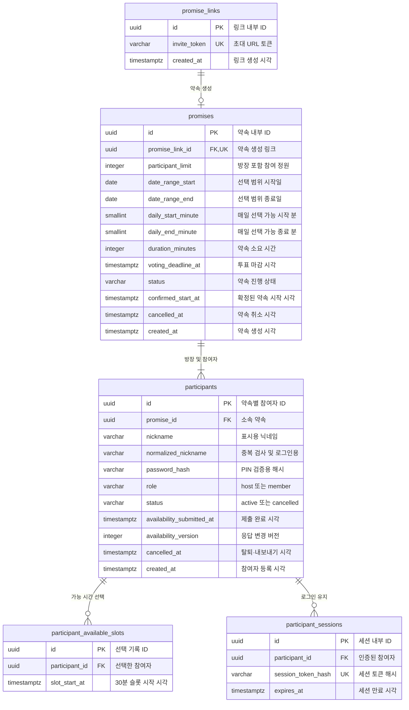

# DATABASE — 약속잡기 도우미 ERD (신버전)

> 원본: Notion 「ERD (신버전)」 https://app.notion.com/p/3f87085f318280dc973cf9f53bca34b5
> 작성일: 2026-09-23 · 추출일: 2026-10-30
> **이 문서는 Prisma 스키마와 마이그레이션의 직접 기준이다.**
> 비즈니스 규칙(`../specs/rules/`)과 충돌하면 비즈니스 규칙을 우선한다.

# 약속잡기 도우미 — 시간 조율 ERD 설명서

작성일: 2026-09-23

범위: 30분 단위 시간 선택, 투표 마감, 시간 후보 추천 및 방장 확정까지의 MVP 설계

## 1. 설계 결론

현재의 5개 테이블 구조를 유지하고, 같은 참여자의 여러 브라우저 간 제출 충돌을 감지하기 위해 `participants.availability_version`을 추가한다. ERD만으로는 마감·정원·권한·동시 요청을 보장할 수 없다. DB 제약과 서버 트랜잭션을 함께 구현해야 한다. 이 문서는 구현 명세이며 실제 DB나 서버에 적용·검증을 완료했다는 의미는 아니다.

- 링크는 약속 생성 전에도 존재한다. 최초 사용자의 명시적인 방장 등록 요청으로 약속과 방장을 함께 생성한다.
- 방장은 `participants.role`로 구분한다. `promises.host_participant_id`는 사용하지 않아 순환 참조를 없앤다.
- 모든 PK와 해당 FK는 UUID를 사용한다.
- 참여자는 약속별 닉네임·PIN으로 인증한다. 전역 회원 테이블은 없다.
- 가능 시간은 30분 슬롯마다 한 행으로 저장한다.
- 전원 제출만으로 마감하지 않는다. 지정 시각 또는 방장의 조기 마감으로 투표를 종료한다.
- 후보는 약속 길이 전체에 참석할 수 있는 인원수 내림차순, 시작 시각 오름차순으로 계산한다.
- 방장은 투표에 포함하지만 방장 참석을 후보의 필수 조건으로 삼지 않는다.
- 기준 시간대는 `Asia/Seoul`로 고정한다.

## 2. 전체 ERD



약속에 참여자가 최소 한 명이라는 관계는 약속·방장 생성 트랜잭션이 커밋된 이후의 서비스 규칙이다. FK만으로 참여자 존재를 강제한다는 의미는 아니다. 복합 UNIQUE와 조건부 UNIQUE는 4절에 별도로 정의한다.

## 3. 컬럼 설명

모든 시점 컬럼은 @db.Timestamptz(3)으로 지정한다.

### 3.1 `promise_links` — 초대 링크

| 컬럼 | NULL | 역할 |
| --- | --- | --- |
| `id` | 불가 | 링크 행의 내부 UUID. 약속이 이 값을 참조한다. |
| `invite_token` | 불가 | 초대 URL에 넣는 암호학적 난수 토큰. 내부 UUID 및 로그인 토큰과 별개다. |
| `created_at` | 불가 | 링크 생성 시각. 오래된 미사용 링크 확인·정리 등에 활용한다. |

연결된 `promises` 행이 없으면 아직 선점되지 않은 링크다. 연결된 약속이 있으면 선점 완료이므로 `status`, `claimed_at`을 중복 저장하지 않는다. 링크 미리보기나 단순 GET 요청은 방장 선점·약속 생성을 일으키면 안 된다. 챗봇 삭제는 기존 링크 및 약속 삭제로 연결하지 않는다.

### 3.2 `promises` — 설정·상태·확정 결과

| 컬럼 | NULL | 역할 |
| --- | --- | --- |
| `id` | 불가 | 약속 내부 UUID. |
| `promise_link_id` | 불가 | 소속 초대 링크 ID. UNIQUE로 한 링크당 약속 최대 하나를 보장한다. |
| `participant_limit` | 설정 중 허용 | 방장 포함 활성 참여 정원. 2명 이상 30명 이하이며 탈퇴·제외된 참여자는 정원 집계에서 제외한다. |
| `date_range_start` | 설정 중 허용 | 선택할 수 있는 첫 날짜. 해당 날짜 포함. |
| `date_range_end` | 설정 중 허용 | 선택할 수 있는 마지막 날짜. 해당 날짜 포함. 응답 마감일과는 다르다. |
| `daily_start_minute` | 설정 중 허용 | 한국 시각 자정부터 선택 시작 경계까지의 분. 0\~1410의 30분 배수. 예: 09:00은 540. |
| `daily_end_minute` | 설정 중 허용 | 한국 시각 자정부터 선택 종료 경계까지의 분. 30\~1440의 30분 배수. 1440은 24:00을 뜻한다. |
| `duration_minutes` | 설정 중 허용 | 약속 전체 길이. 30분 이상의 30분 배수. 예: 90분. |
| `voting_deadline_at` | 설정 중 허용 | 응답 수정이 종료되는 절대 시각. 서버 판정 시각이 이 값 이상이면 수정 불가. |
| `status` | 불가 | draft / collecting / closed / confirmed / cancelled 중 하나. |
| `confirmed_start_at` | 허용 | 최종 약속 시작 날짜·시각. 확정 전과 재조율 시 NULL. |
| `cancelled_at` | 허용 | 약속이 cancelled로 전환된 실제 시각. 취소 전에는 NULL. |
| `created_at` | 불가 | 실제 약속이 생성된 시각. 링크 발급 시각과 다를 수 있다. |

확정 종료 시각은 `confirmed_start_at + duration_minutes`로 계산한다. `confirmed_at`처럼 "확정 버튼을 누른 시각"이 아니라 "실제 만나는 시작 시각"이라는 점에 주의한다. 확정 중 소요 시간 변경은 금지하며 변경하려면 재조율한다.

일일 선택 경계는 `SMALLINT` 분 값으로 저장하고 화면·API에서만 HH:mm 문자열로 변환한다. 종료 경계에는 24:00을 허용하며 DB 값은 1440이다. `TIMESTAMPTZ`는 실제 시점을 나타내며 화면 및 날짜 경계 계산에는 항상 Asia/Seoul을 명시한다.

### 3.3 `participants` — 약속별 참여자

| 컬럼 | NULL | 역할 |
| --- | --- | --- |
| `id` | 불가 | 참여 기록 UUID. 같은 사람이 약속 두 개에 참여하면 서로 다른 ID가 생긴다. |
| `promise_id` | 불가 | 소속 약속 ID. 참여자 생성 후 다른 약속으로 옮기지 않는다. |
| `nickname` | 불가 | 화면 표시 이름. |
| `normalized_nickname` | 불가 | 닉네임 정규화 결과. 등록과 로그인에서 동일 규칙을 사용한다. |
| `password_hash` | 불가 | 약속별 PIN 검증용 해시. PIN 원문은 저장하지 않는다. |
| `role` | 불가 | host 또는 member. 방장 권한의 기준. |
| `status` | 불가 | active는 정상 참여, cancelled는 탈퇴·제외. 온라인 여부나 특정 슬롯의 가능 여부가 아니다. |
| `availability_submitted_at` | 허용 | 현재 제출 완료 시각. NULL이면 미제출 또는 재제출 필요, 값이 있으면 제출 완료. |
| `availability_version` | 불가 | 참여자별 응답 변경 버전. 기본값 0, 슬롯이나 제출 상태가 DB에서 바뀌는 트랜잭션마다 1 증가. 브라우저 동기화 및 오래된 제출 거부에 사용한다. |
| `cancelled_at` | 허용 | 참여자가 탈퇴하거나 내보내진 실제 시각. active 상태에서는 NULL. |
| `created_at` | 불가 | 참여자 등록 시각. 등록순 표시 등에 활용한다. |

가능 슬롯이 0개여도 "가능한 시간 없음"으로 제출할 수 있다. 설정 변경으로 재제출이 필요해지면 제출 시각을 NULL로 되돌리고 버전을 증가시킨다. 제출 시각이 NULL에서 NULL로 유지되더라도 서버의 슬롯이 바뀌면 버전을 증가시킨다. 브라우저에만 저장된 선택은 DB 버전을 바꾸지 않는다. 현재 정규화 닉네임 UNIQUE는 탈퇴한 행에도 적용되므로 닉네임이 자동 해제되지 않는다.

### 3.4 `participant_available_slots` — 30분 가능 시간

| 컬럼 | NULL | 역할 |
| --- | --- | --- |
| `id` | 불가 | 슬롯 선택 행의 UUID. |
| `participant_id` | 불가 | 이 시간을 선택한 참여자 ID. |
| `slot_start_at` | 불가 | 해당 30분 구간의 시작 날짜·시각. 종료는 시작 + 30분으로 계산한다. |

철수가 09:00\~10:30을 선택하면 09:00, 09:30, 10:00 시작 슬롯을 각각 한 행씩 저장한다. 구간은 `[시작, 종료)`로 해석한다. 10:00\~10:30과 10:30\~11:00은 겹치지 않고 이어진다.

선택 해제는 행 삭제로 처리한다. `available_date`, `promise_id`, `availability_status`, 개별 슬롯 생성·수정 시각은 저장하지 않는다. 소속 약속은 참여자를 통해 찾는다.

### 3.5 `participant_sessions` — 로그인 유지

| 컬럼 | NULL | 역할 |
| --- | --- | --- |
| `id` | 불가 | 세션 행 UUID. 인증용 비밀값 자체가 아니다. |
| `participant_id` | 불가 | 인증된 참여자 ID. |
| `session_token_hash` | 불가 | 브라우저에 발급한 원본 난수 세션 토큰의 해시. |
| `expires_at` | 불가 | 만료 시각. 현재 시각이 같거나 늦으면 사용 불가. |

기기별 여러 세션을 허용한다. 사용자의 명시적인 로그아웃은 해당 세션 행을 삭제한다. 약속 취소·참여자 탈퇴·내보내기 시에는 관련 세션 행을 삭제하지 않고 `expires_at`을 현재 시각으로 변경하여 즉시 만료한다. 요청마다 세션 만료 여부와 현재 역할·참여 상태·약속 상태를 다시 검사한다.

## 4. DB 제약조건

### 4.1 UNIQUE와 FK

| 테이블 | 제약 |
| --- | --- |
| promise\_links | UNIQUE(invite\_token) |
| promises | UNIQUE(promise\_link\_id), FK → promise\_[links.id](http://links.id/) ON DELETE RESTRICT |
| participants | UNIQUE(promise\_id, normalized\_nickname), FK promise\_id → [promises.id](http://promises.id/) ON DELETE RESTRICT |
| participants | role = 'host' 행에 한해 promise\_id UNIQUE |
| participant\_available\_slots | UNIQUE(participant\_id, slot\_start\_at), FK participant\_id → [participants.id](http://participants.id/) ON DELETE RESTRICT |
| participant\_sessions | UNIQUE(session\_token\_hash), FK participant\_id → [participants.id](http://participants.id/) ON DELETE RESTRICT |

```sql
CREATE UNIQUE INDEX uq_one_host_per_promise
ON participants (promise_id)
WHERE role = 'host';
```

모든 FK는 `ON DELETE RESTRICT`로 두며 자동 CASCADE를 사용하지 않는다. 정상적인 약속 취소·참여자 탈퇴·세션 만료에는 물리 DELETE를 사용하지 않는다. 10분 만료 draft 정리와 draft 탈퇴에서는 세션 → 방장 참여자 → promise 순서로 자식을 명시적으로 삭제하고 promise\_link는 보존한다.

이 인덱스는 방장 최대 한 명만 보장한다. 취소되지 않은 약속에는 active host가 정확히 한 명 존재해야 한다는 조건은 서비스 불변식으로 둔다. 약속·방장 생성과 방장 승계·탈퇴는 promises 행을 먼저 잠그고 단일 트랜잭션으로 처리한다. 위임·자동 승계에서는 기존 host를 member로 변경한 다음 새 host를 지정한다. 단, 방장 탈퇴 요청 시 후임 active 참여자가 없으면 참여자 탈퇴를 완료하지 않고 약속 전체 취소로 전환한다. 이 예외에서는 기존 방장의 `role=host`, `status=active`, `cancelled_at=NULL`을 그대로 보존하고 약속만 `status=cancelled`, `cancelled_at=clock_timestamp()`로 변경한다. cancelled 약속에는 active host 존재 불변식을 적용하지 않으며 모든 참여자 세션을 즉시 만료한다.

복합 UNIQUE는 각 컬럼을 독립적으로 UNIQUE로 지정한다는 뜻이 아니다. NULL이 포함된 조합이 제약을 우회하지 않도록 관련 필드는 NOT NULL로 둔다.

### 4.2 같은 행에서 검증할 조건

- status·role 값은 CHECK 또는 ENUM으로 허용 목록에 제한한다.
- `role='host'`인 참여자는 반드시 `status='active'`여야 한다.
- 설정된 `participant_limit`은 방장을 포함해 2 이상 30 이하이다.
- `date_range_start ≤ date_range_end`이며 `date_range_end`는 한국 시간 오늘부터 3개월 이내(달력의 월 단위로 계산)이다. 오늘 기준 조건이므로 CHECK가 아니라 서버에서 검증한다.
- `daily_start_minute`은 0 이상 1410 이하, `daily_end_minute`은 30 이상 1440 이하이다.
- 두 분 값은 30의 배수이며 `daily_start_minute < daily_end_minute`여야 한다.
- `daily_end_minute=1440`은 해당 날짜의 24:00 종료 경계이며 다음 날까지 이어지는 선택 범위를 뜻하지 않는다.
- `duration_minutes`는 30 이상·30의 배수이고 `daily_end_minute - daily_start_minute` 이하이다.
- `slot_start_at`은 한국 기준 00분 또는 30분이며 초·소수 초는 0이다.
- promises는 `status='cancelled'`일 때만 `cancelled_at`이 존재하고, 다른 상태에서는 NULL이다.
- participants도 `status='cancelled'`일 때만 `cancelled_at`이 존재하고, active 상태에서는 NULL이다.
- 상태별 필수값은 아래 표대로 검사한다. NULL 허용 컬럼의 단순 비교 CHECK만으로 필수값을 보장할 수 없으므로 IS NOT NULL 조건이 필요하다.

```sql
ALTER TABLE participants
ADD CONSTRAINT ck_host_must_be_active
CHECK (role <> 'host' OR status = 'active');

ALTER TABLE promises
ADD CONSTRAINT ck_promise_cancelled_at
CHECK ((status = 'cancelled') = (cancelled_at IS NOT NULL));

ALTER TABLE participants
ADD CONSTRAINT ck_participant_cancelled_at
CHECK ((status = 'cancelled') = (cancelled_at IS NOT NULL));
```

| 상태 | 정원·날짜·일일 시간·소요 시간·마감 | confirmed\_start\_at | cancelled\_at |
| --- | --- | --- | --- |
| draft | 미설정 값 NULL 허용, 입력된 값은 유효해야 함 | NULL | NULL |
| collecting | 모두 필수 | NULL | NULL |
| closed | 모두 필수 | NULL | NULL |
| confirmed | 모두 필수 | 필수 | NULL |
| cancelled | 취소 전 값 유지. 초안에서 취소했다면 NULL 가능 | 이전 값 유지 가능 | 필수 |

현재 시각과의 비교나 다른 테이블의 데이터 확인은 일반 CHECK에 의존하지 않고 서버에서 판정한다.

### 4.3 조회 인덱스

UNIQUE와 PK에는 인덱스가 생성되므로 동일한 인덱스를 중복 생성하지 않는다.

- UNIQUE(participant\_id, slot\_start\_at): 참여자별 슬롯 및 기간 조회에 활용.
- UNIQUE(promise\_id, normalized\_nickname): 약속별 참여자 조회에도 활용 가능.
- participant\_sessions(participant\_id): 참여자의 모든 세션 조회·폐기용 추가 인덱스 권장.
- promises(voting\_deadline\_at) WHERE status = 'collecting': 마감 처리 작업이 주기적으로 약속을 찾는 경우 추가 검토.

FK 선언만으로 참조하는 쪽에 조회 인덱스가 자동 생성되는 것은 아니다. 세부 인덱스 최적화는 실제 실행 계획을 보고 판단한다.

## 5. 시간 범위 검증 — 보완 사항

### 5.1 슬롯 전체가 범위 안에 들어와야 함

슬롯 시작만 범위 안인지 검사하면 안 된다. 날짜 D의 한국 시각 자정에 분 값을 더해 시작·종료 경계를 계산한다.

```txt
date_range_start ≤ D ≤ date_range_end
시작 경계 = D 00:00(Asia/Seoul) + daily_start_minute
종료 경계 = D 00:00(Asia/Seoul) + daily_end_minute

slot_start_at ≥ 시작 경계
slot_start_at + 30분 ≤ 종료 경계
```

`daily_end_minute=1440`이면 종료 경계는 다음 날 00:00이지만 해당 날짜 D의 종료 경계로 해석한다. 예를 들어 마지막 선택 날짜의 23:30\~다음 날 00:00은 그 마지막 날짜에 속한 마지막 슬롯이다. 이는 자정을 넘어 다음 날 시간대까지 이어지는 약속을 허용한다는 뜻이 아니다.

API는 시작·종료 시각을 `HH:mm` 문자열로 주고받으며 종료 시각에 한해 `24:00`을 허용한다. 서버는 `00:00=0`, `23:30=1410`, `24:00=1440`으로 변환한다.

### 5.2 과거 및 마감 판정

- 지난 슬롯(시작 ≤ 현재)은 새로 저장하지 않는다. 제출 요청에 섞여 오면 거절하지 않고 무시하며, 이미 저장된 지난 슬롯은 재제출 때 삭제하지 않고 보존한다.
- collecting으로 열거나 재조율할 때 마감 시각은 현재보다 미래여야 한다.
- 마감이 선택 범위의 첫날보다 반드시 앞서야 하는 것은 아니다. 다만 마감 이후에도 약속 길이를 충족하는 미래 후보 시작점이 설정 범위에 남는지 확인하는 것을 권장한다.
- 실제 확정 요청 시에도 후보 시작이 미래인지 재검사한다.
- 모든 시간 기준은 서버가 판정하며 사용자 기기 시각을 신뢰하지 않는다.

## 6. 상태·권한·재조율

### 6.1 상태 전이

```txt
링크만 존재 → 방장 등록 및 약속 생성(draft)
draft → collecting : 필수 설정 완료
collecting → closed : 마감 시각 도달 또는 방장 조기 마감
closed → confirmed : 유효 후보를 방장이 선택
closed / confirmed → collecting : 새 마감 시각을 정하고 재조율
취소되지 않은 상태 → cancelled : 방장 취소
```

전원 제출만으로는 마감하지 않는다. 응답이 0명 또는 1명이더라도 기한 도달 시 마감한다. 후보 최소 2명 조건은 "확정 가능한 후보"의 조건이지 마감을 막는 조건이 아니다. cancelled에서 복원하는 기능은 이번 MVP 범위에 포함하지 않는다.

### 6.2 상태별 제한

- `draft`: 방장만 설정할 수 있으며 다른 참여자의 신규 참여는 허용하지 않는다.
- `collecting`이면서 현재 시각이 마감 전인 경우:
  - 정원 안에서 신규 참여를 허용한다.
  - 참여자는 본인의 가능 시간을 제출·재제출할 수 있다.
  - 참여자 본인은 탈퇴할 수 있다.
  - 방장은 다른 참여자를 내보낼 수 있다.
- `closed`:
  - 신규 참여, 가능 시간 제출·재제출, 방장의 참여자 내보내기를 허용하지 않는다.
  - 참여자 본인의 탈퇴는 허용한다.
  - 탈퇴자는 `participants.status=cancelled`로 변경하고 모든 활성 인원·정원·후보 집계에서 제외한다.
  - 약속 상태는 `closed`로 유지하며 공식 후보는 다음 조회에서 최신 active 참여자를 기준으로 다시 계산한다.
- `confirmed`:
  - 신규 참여, 가능 시간 제출·재제출, 방장의 참여자 내보내기를 허용하지 않는다.
  - 참여자 본인의 탈퇴는 허용한다.
  - 탈퇴자는 참석자 명단과 활성 인원 집계에서 제외한다.
  - 약속 상태와 `confirmed_start_at`은 유지한다.
  - 참석 가능 인원이 2명 미만이어도 확정을 자동으로 해제하거나 약속을 자동으로 취소하지 않는다.
  - 방장에게 참석 인원 감소를 알리고 재조율 또는 취소를 선택하게 한다.
- `cancelled`:
  - 신규 참여, 탈퇴, 투표, 확정, 재조율 및 일반 관리 변경을 모두 차단한다.
  - 화면과 API에는 취소된 약속이라는 안내만 제공한다.

본인 탈퇴와 방장의 참여자 내보내기는 구분한다. 본인 탈퇴는 `draft`, `collecting`, `closed`, `confirmed`에서 허용하지만, 방장의 내보내기는 `collecting`이면서 마감 전일 때만 허용한다.

단, draft에서의 탈퇴는 상태 변경이 아니라 초안 폐기로 처리한다. 10분 만료 draft와 동일하게 세션 → 방장 참여자 → promise 순서로 물리 삭제하고 링크를 재사용 가능한 상태로 되돌린다.

일반 참여자 또는 후임자가 존재하는 방장이 탈퇴하면 참여자 행과 닉네임, PIN 해시, 가능 시간, 제출 기록을 물리 삭제하지 않는다. 탈퇴자를 `participants.status=cancelled`, `participants.cancelled_at=clock_timestamp()`로 변경하고 세션은 행을 삭제하지 않은 채 `expires_at`을 현재 시각으로 변경하여 즉시 만료한다.

방장이 탈퇴하면 본인을 제외한 active 참여자 중 `created_at ASC, id ASC` 순서의 첫 참여자에게 방장 권한을 자동으로 승계한 뒤 기존 방장을 탈퇴 처리한다. 제출 여부는 승계 조건으로 사용하지 않는다.

단, 승계할 active 참여자가 없으면 마지막 방장의 참여자 탈퇴를 완료하지 않고 약속 전체 취소로 전환한다. 기존 방장의 `role=host`, `status=active`, `cancelled_at=NULL`은 그대로 유지하고, 약속만 `status=cancelled`, `cancelled_at=clock_timestamp()`로 변경한다. 이는 이미 cancelled인 약속에서 탈퇴를 허용한다는 뜻이 아니라, 취소되지 않은 약속에서 시작된 마지막 방장의 탈퇴 요청이 원자적으로 약속 취소로 전환되는 예외다. 약속의 모든 참여자 세션을 즉시 만료하므로 기록상 active인 마지막 방장도 이후 인증·조회·수정할 수 없다.

방장도 다른 참여자의 가능 시간이나 제출 상태를 임의로 수정할 수 없다.

### 6.3 설정 변경과 재조율

`collecting` 상태에서 설정을 바꾸는 것은 재설정이며 약속 상태를 유지한다. `closed` 또는 `confirmed`에서 다시 응답을 받기 위해 `collecting`으로 되돌리는 것은 재조율이다.

1. 방장 권한과 현재 상태를 확인한다.
2. 변경 후 설정을 검증한다. 재조율에서는 현재보다 미래인 새 마감 시각을 반드시 검증한다.
3. confirmed에서 재조율하는 경우에만 `confirmed_start_at=NULL`로 변경한다.
4. 날짜·하루 시간 범위를 변경하면 새 범위를 벗어난 슬롯을 제거하고 범위 안의 기존 슬롯은 유지한다.
5. 범위가 줄어들기만 하면 제출 상태를 유지한다. 실제 슬롯이 삭제된 참여자의 `availability_version`만 증가시킨다.
6. 새로운 선택 가능 슬롯이 하나라도 추가되는 확대·이동이면 모든 active 참여자의 `availability_submitted_at=NULL` 처리와 `availability_version+1`을 수행한다. 제출 시각이 이미 NULL이어도 버전을 증가시킨다.
7. 범위가 그대로이고 소요 시간만 바뀌면 슬롯·제출 상태·버전을 유지하고 후보만 다시 계산한다.
8. 모집 중 재설정은 `status=collecting`을 유지한다. closed·confirmed의 재조율은 `status=collecting`으로 변경하고 관련 변경을 한 번에 커밋한다.

정원은 2명 이상 30명 이하이며 현재 활성 참여 인원보다 작게 설정할 수 없다. confirmed 상태에서 `duration_minutes`만 직접 바꿔 실제 종료 시각을 변경하는 것은 금지하며 재조율을 통해 처리한다. 재조율 이전 확정 결과·후보 이력은 현재 구조로 보존하지 않는다.

## 7. 추천 시간 계산

### 7.1 대상과 순위

공식 후보는 마감된 약속의 전체 선택 날짜 범위를 대상으로 계산한다. 프로토타입처럼 화면에 보이는 한 주만 대상으로 계산하지 않는다.

1. active이고 availability\_submitted\_at이 있는 참여자만 집계한다.
2. 약속 범위 안의 미래 30분 경계 시각을 후보 시작으로 만든다.
3. 시작 + duration\_minutes가 같은 날의 선택 종료 경계를 넘는 후보는 제외한다.
4. 약속 길이에 해당하는 모든 연속 슬롯에 가능한 동일 참여자들의 수를 계산한다.
5. 2명 미만 후보는 제외한다.
6. 가능 인원 내림차순, 시작 시각 오름차순으로 정렬한다.
7. 상위 5개를 기본 표시하며 나머지는 추가 조회할 수 있다.

예를 들어 60분 후보 10:00\~11:00에는 10:00 슬롯과 10:30 슬롯에 모두 가능한 사람만 포함한다. 각 슬롯의 인원수를 더하거나 인원수의 최솟값만 사용하는 것은 잘못된 계산이다. 두 슬롯의 참여자 명단이 다를 수 있기 때문이다.

방장도 한 명으로 집계하며, 방장이 참석하지 못하는 시간도 다른 참여자 2명 이상이 가능하면 후보가 될 수 있다. 방장 필수 참석 옵션은 현재 도입하지 않는다.

### 7.2 확정 및 빈 결과

- 방장은 유효 후보 중 하나를 선택한다. 추천 1순위 선택은 강제하지 않는다.
- 서버가 후보를 다시 계산·검증한 뒤 confirmed\_start\_at과 status=confirmed를 저장한다. 클라이언트가 보낸 가능 인원·순위는 신뢰하지 않는다.
- 미래 후보가 없으면 closed를 유지하고 재조율 또는 취소를 안내한다.
- 시간이 지나면 과거 후보를 제외하므로 참여 데이터가 고정돼 있어도 표시 목록은 달라질 수 있다.
- 같은 인원수의 연속 구간이라고 같은 사람들이 가능한 것은 아니다. 공통 영역을 묶어 표시할 때는 참여자 집합도 확인한다.

### 7.3 히트맵과 저장하지 않는 값

히트맵은 30분 슬롯별 가능 인원, 공식 추천은 약속 길이 전체의 공통 가능 인원이다. 둘은 서로 다른 지표다.

현재 주, 내 시간/전체 시간 모드, 드래그 상태, 인원수, 후보 순위, 히트맵 색상은 UI 상태 또는 계산 결과이므로 저장하지 않는다. 추천 후보 테이블도 만들지 않는다. 수집 중 결과를 보여준다면 "임시 집계"라고 표시하고 제출 완료 응답만 포함하는지 정책을 일관되게 적용한다. 미제출과 빈 선택 제출은 모두 불가능으로 표시하고, 분모는 active 전체, 제출 여부는 공개하지 않는다.

## 8. 동시 요청·원자성 — 핵심 보완 사항

단순히 트랜잭션을 사용한다는 것만으로 충분하지 않다. 같은 약속을 변경하는 모든 경로가 동일한 잠금 규칙을 따라야 한다.

### 8.1 생성

방장 등록 요청에서는 링크 행을 잠그고 연결된 약속이 없는지 확인한 뒤 약속·host 참여자를 함께 생성한다. 하나라도 실패하면 전체 롤백한다. promise\_link\_id의 UNIQUE가 중복 약속 생성을 추가로 방어한다.

### 8.2 약속 변경

MVP 권장 패턴은 해당 promises 행을 먼저 FOR UPDATE로 잠그고, 최신 상태·권한·마감·정원을 확인한 후 변경하는 것이다. 참여자·슬롯을 변경하는 요청도 이 규칙을 따라야 한다. 부모 행 잠금만으로 모든 자식 변경이 자동 통제되는 것은 아니다.

| 요청·처리 | 같은 트랜잭션에서 할 일 |
| --- | --- |
| 신규 참여 | 약속 상태·마감·정원 검사 + 닉네임 중복 검사 + 참여자 생성 |
| 가능 시간 제출·재제출 | 권한·상태·마감·범위 검사 + 요청의 기준 `availability_version`과 DB 최신 버전 비교 + 최종 슬롯 저장 + `availability_submitted_at` 기록 + `availability_version` 증가 |
| 오래된 버전으로 제출 | 슬롯과 제출 상태를 변경하지 않고 요청 거절 + 최신 `availability_version`, 슬롯, 제출 상태 반환 |
| 범위 축소에 따른 서버 변경 | 범위 밖 슬롯 제거 + 제출 상태 유지 + 실제 슬롯이 삭제된 참여자의 `availability_version` 증가 |
| 범위 확대·이동에 따른 제출 초기화 | 모든 active 참여자의 availability\_submitted\_at=NULL + availability\_version 증가 + 재제출 필요 상태로 변경 |
| 허용된 설정 변경 또는 재조율 중 소요 시간만 변경 | 기존 슬롯과 제출 상태 유지 + 변경된 소요 시간으로 후보 재계산. `confirmed` 상태의 직접 변경은 거절하고 재조율을 통해 처리 |
| 조기 마감·기한 도달 마감 | 잠금 후 최신 마감 시각 검사 + `collecting → closed` 저장. GET 요청은 `effectiveStatus=closed`만 계산하고 DB status는 변경하지 않음 |
| 일반 참여자 탈퇴 | 참여자 `status=cancelled`, `cancelled_at=clock_timestamp()` 변경 + 슬롯·제출 기록 보존 + 관련 세션 즉시 만료 + 정원·후보·참석자 집계에서 제외 |
| 방장 탈퇴·자동 승계 | 최신 host 여부 확인 + 후임 active 참여자를 `created_at ASC`, `id ASC`로 선정. 후임자가 있으면 기존 방장을 `role=member`, `status=cancelled`, `cancelled_at=clock_timestamp()`로 변경하고 새 방장을 `role=host`로 지정. 후임자가 없으면 기존 방장의 `role=host`, `status=active`, `cancelled_at=NULL`을 유지하고 약속만 `status=cancelled`, `cancelled_at=clock_timestamp()`로 변경한 뒤 모든 참여자 세션을 즉시 만료 |
| 최종 일정 확정 | `closed` 상태·방장 권한·미래 시각·범위·공통 가능 인원 재검증 + `confirmed_start_at` 저장 + `status=confirmed` 변경 |
| 재조율 | 새 설정과 미래 마감 검증 + 필요 시 `confirmed_start_at=NULL` + 범위 밖 슬롯 제거 + 재제출 필요 여부에 따른 제출 상태·버전 처리 + `status=collecting` 변경 |
| 약속 취소 | 방장 권한과 현재 상태 검사 + `promises.status=cancelled`, `promises.cancelled_at=clock_timestamp()` 변경 + 참여자 role·status를 포함한 관련 데이터 보존 + 모든 참여자 세션 즉시 만료 |

마감 판정 시각은 잠금을 획득한 뒤의 서버/DB 현재 시각으로 통일하는 것을 권장한다. 요청 시작이 마감 전이어도 잠금 대기 후 마감을 지났다면 거절한다. PostgreSQL NOW()는 트랜잭션 시작 시각이므로 이 정책에서는 잠금 후 실제 현재 시각을 판정하는 방식을 사용한다. 스케줄러 실행이 지연되어도 각 쓰기 요청에서 마감을 검사하므로 늦은 투표는 허용되지 않는다. (P1 자동 마감 도입 시)

브라우저의 임시 선택은 제출 전까지 로컬에만 저장한다. 제출 요청에는 브라우저가 읽은 기준 `availability_version`과 최종 슬롯 집합을 포함한다. 기준 버전이 DB 최신 버전과 일치하면 최종 슬롯·제출 시각을 저장하고 버전을 1 증가시킨다. 버전이 다르더라도 요청한 최종 슬롯 집합과 제출 상태가 현재 DB 값과 완전히 같으면 응답만 유실된 동일 결과의 재시도로 보고 추가 변경·버전 증가 없이 200과 현재 최신 버전을 반환한다. 버전이 다르고 최종 데이터도 다르면 아무것도 변경하지 않고 `409 AVAILABILITY_VERSION_CONFLICT`와 최신 버전·슬롯·제출 상태를 반환한다. 성공 응답은 항상 최신 `availability_version`을 포함한다. 중복 슬롯 행은 복합 UNIQUE로 막는다.

약속 설정 전용 버전 컬럼은 두지 않는다. 화면이 열려 있는 동안 STATE-API-01을 주기적으로 조회하고 이전에 받은 settings 객체와 최신 settings 객체를 비교하여 설정 변경을 감지한다. 여러 방장 화면의 설정 변경 요청은 promises 행 잠금으로 직렬화하며 최신 요청의 최종 설정을 적용한다.

같은 참여자의 여러 브라우저는 폴링 응답의 `availability_version`을 비교한다. 서버 버전이 로컬 입력의 기준 버전과 다르면 로컬 미제출 입력을 폐기하고 최신 서버 슬롯과 제출 상태를 표시하며, 서버의 가능 시간 데이터가 변경되었음을 안내한다. 이 버전은 참여자의 다른 기기 제출과 설정 변경에 따른 서버 조정을 모두 포함하며 변경 원인 자체를 구분하지 않는다. 제출 요청에는 브라우저가 읽은 버전을 포함한다. 서버는 약속 행 잠금 규칙에 따라 최신 버전과 비교한 뒤 일치할 때만 슬롯·제출 시각·버전을 한 트랜잭션으로 변경한다. 버전이 다르면 오래된 제출을 거부하고 최신 데이터를 반환한다. 다른 참여자들의 전체 가능 시간 화면은 전체 제출 데이터를 폴링해 갱신하므로, 이 참여자별 버전 하나로 전체 약속의 변경 여부를 판단하지 않는다. 단, 내용이 같은 재시도는 위 규칙대로 200을 반환한다.

## 9. 인증·접근 권한 주의점

- 초대 토큰은 약속 접근용, PIN은 참여자 재인증용, 세션 토큰은 로그인 유지용이다. UUID 자체는 권한이 아니다.
- 변경 API는 세션 참여자가 대상 약속에 속하는지 확인한다. 클라이언트 participant\_id 또는 isHost 값을 믿지 않는다.
- 4자리 PIN은 10,000가지뿐이다. 해시는 원문 저장을 피하는 수단이지 짧은 PIN을 강하게 만드는 수단이 아니다.
- 약속·참여자 기준 및 IP 기준 시도 제한, 실패 메시지 통일, 로그에 비밀값 미기록, HTTPS, 안전한 쿠키 설정과 CSRF 방어가 필요하다.
- 세션 만료 여부와 현재 active 상태를 매 요청 확인한다. PIN 변경 시 기존 세션 폐기 정책을 적용한다.
- PIN 분실 및 방장 복구할 수 없으며 방장 권한 복구 기능도 두지 않는다. 닉네임만으로 초기화하거나 방장 권한을 넘겨주면 안 된다.
- 참여 제외만으로 동일인이 새 닉네임으로 재가입하는 것을 완전히 막지는 못한다. 현재 비회원 구조의 한계이며 필요하면 초대 재발급·가입 승인 등 별도 기능이 필요하다.

## 10. 보존·삭제 정책

약속 취소와 참여자 탈퇴는 상태 변경으로 처리하며 관련 데이터를 물리 삭제하지 않는다.

단, draft에서의 탈퇴는 아래 물리 삭제 예외를 따른다.

약속이 취소되면 `promises.status=cancelled`, `promises.cancelled_at=clock_timestamp()`로 변경하고 설정, 참여자, 닉네임, PIN 해시, 가능 시간, 제출 기록 및 확정 일정을 보존한다.

참여자가 탈퇴하거나 내보내지면 `participants.status=cancelled`, `participants.cancelled_at=clock_timestamp()`로 변경하고 해당 참여자의 닉네임, PIN 해시, 가능 시간 및 제출 기록을 보존한다. 보존된 데이터는 정원, 후보, 참석자 및 가능 인원 집계에서 제외한다.

약속 취소·참여자 탈퇴·내보내기 시 관련 세션 행은 삭제하지 않고 `expires_at`을 현재 시각으로 변경하여 즉시 만료한다. 사용자가 명시적으로 로그아웃한 경우의 현재 세션 삭제는 별도의 인증 정책을 따른다.

MVP에서는 취소·탈퇴 데이터를 자동 삭제하지 않는다. `cancelled_at`은 취소·탈퇴 발생 시각 기록과 향후 보존 정책의 기준으로만 사용하며 취소 원인은 별도로 저장하지 않는다.

물리 삭제 예외는 draft뿐이며 두 경우에 적용한다.

① 설정을 완료하지 못하고 10분이 지난 경우

② 방장이 draft에서 탈퇴(나가기)를 요청한 경우.

두 경우 모두 promise\_link → promises 순서로 잠근 뒤 세션 → 방장 참여자 → promise 순서로 명시적으로 삭제하고 promise\_link는 미사용 상태로 보존한다. GET은 10분 만료 여부만 계산하고 DB를 변경하지 않는다. 만료 draft는 기존 방장 또는 새 방장의 쓰기 요청이 발견했을 때 삭제한다.

슬롯 선택 해제와 범위 축소로 제외된 슬롯은 `participant_available_slots` 행을 삭제하여 반영한다. 이는 약속 취소나 참여자 탈퇴에 따른 데이터 삭제와 구분한다.

모든 FK는 `ON DELETE RESTRICT`를 사용하며 자동 CASCADE를 적용하지 않는다.

## 11. 구현 검증 체크리스트

| 사례 | 기대 결과 |
| --- | --- |
| 두 사용자가 같은 링크를 동시에 선점 | 약속 하나와 방장 한 명만 생성 |
| 정원 1자리가 남았을 때 두 명이 동시에 참여 | 한 명만 등록 |
| 정원 31명으로 모집 시작 또는 재조율 요청 | 422로 거절 |
| 같은 참여자의 동일 슬롯 중복 저장 | 슬롯 행 하나만 유지 |
| 다른 약속의 참여자 ID로 슬롯 수정 | 거절 |
| 종료 시각이 23:00인 약속에 23:00 시작 슬롯 저장 | 거절 |
| 종료 경계가 24:00인 날짜에 23:30 시작 슬롯 저장 | 해당 날짜의 23:30\~24:00 슬롯으로 허용 |
| 일일 선택 범위 1시간, 소요 시간 2시간 설정 | 거절 |
| 소요 시간 60분이고 각 슬롯 가능 인원은 2명이지만 전체 구간 공통 참석자는 1명 | 후보에서 제외 |
| 응답 0명인 collecting 약속을 기한 후 GET 조회 | `effectiveStatus=closed`, 후보 없음 안내. GET은 DB의 실제 status를 변경하지 않음 |
| DB status가 collecting이지만 기한이 지난 상태에서 쓰기 요청 | 실제 status를 `closed`로 전환한 뒤 해당 수정 요청 거절 |
| 전원이 제출했지만 마감 전 | `collecting` 유지 |
| draft 생성 후 10분이 지난 상태에서 GET 조회 | 만료로 계산해 안내하지만 DB는 변경하지 않음 |
| 만료 draft에 기존 방장 또는 새 방장의 쓰기 요청 | 링크 잠금 후 세션·방장·promise를 명시적으로 삭제하고 링크 재사용 가능 |
| 마감 순간 슬롯 저장과 조기 마감이 경쟁 | 약속 행 잠금과 마감 판정 순서에 따라 직렬 처리 |
| 후보가 화면에 표시된 뒤 시작 시각이 지나 확정 요청 | 확정 거절 및 최신 후보 재조회 안내 |
| 확정 상태에서 소요 시간만 수정 | 거절하고 재조율 안내 |
| 재조율로 날짜·시간 범위를 축소 | 범위 밖 슬롯만 제거하고 제출 상태 유지. 실제 슬롯이 삭제된 참여자의 `availability_version` 증가 |
| 재조율로 날짜·시간 범위를 확대하거나 이동 | 모든 active 참여자의 `availability_submitted_at=NULL`, `availability_version + 1` 후 재제출 요청 |
| 재조율에서 범위는 그대로 두고 소요 시간만 변경 | 슬롯과 제출 상태 유지, 기존 입력으로 후보 재계산 |
| 방장 탈퇴 자동 승계 처리 중 오류 | 전체 트랜잭션 롤백, 기존 방장의 role·status 유지 |
| 방장이 해당 후보 시간에 불가능하고 제출한 다른 참여자 2명이 가능 | 후보에 포함 |
| 슬롯 0개로 가능 시간 제출 | 제출 완료로 기록하되 가능 인원에는 기여하지 않음 |
| `closed` 상태에서 일반 참여자 탈퇴 | 탈퇴 허용, 참여자 `status=cancelled`, 약속은 `closed` 유지, 다음 후보 조회에서 제외 |
| `confirmed` 상태에서 일반 참여자 탈퇴 | 탈퇴 허용, 확정 시간과 약속 상태 유지, 참석자 명단만 갱신 |
| `confirmed` 상태에서 탈퇴 후 참석 가능 인원이 2명 미만 | 자동 확정 해제·자동 취소 없음, 방장에게 재조율·취소 안내 |
| `closed` 또는 `confirmed` 상태에서 방장이 참여자 내보내기 요청 | 거절하고 재조율 후 처리 안내 |
| 방장 탈퇴 시 다른 active 참여자가 존재 | `created_at ASC`, `id ASC` 순서의 첫 참여자에게 자동 승계한 뒤 기존 방장 탈퇴 |
| `collecting`·`closed`·`confirmed`에서 방장 탈퇴 시 다른 active 참여자가 없음 | 방장은 `role=host`, `status=active`, `cancelled_at=NULL`로 보존하고 약속만 `status=cancelled`, `cancelled_at` 기록. 모든 참여자 세션 즉시 만료 |
| 탈퇴 처리 전 발급된 세션 쿠키 재사용 | 세션 만료 또는 참여자 `status=cancelled` 확인 후 `401 UNAUTHENTICATED` 반환 |
| 탈퇴 처리 후 DB 확인 | 참여자·닉네임·PIN 해시·가능 슬롯·제출 기록 보존, cancelled\_at 기록, 모든 active 집계에서 제외 |
| 약속 취소 처리 후 DB 확인 | 설정·참여자·닉네임·PIN 해시·가능 슬롯·제출 기록·확정 일정 보존 및 cancelled\_at 기록 |
| 취소된 약속의 초대 링크 접속 | 취소 안내만 표시하고 설정·참여자·입력·결과는 노출하지 않음 |
| 취소된 약속에 일반 API 요청 | `409 PROMISE_CANCELLED` 반환 |
| 취소된 약속을 복원하거나 재조율 요청 | 거절 |
| draft에서 방장이 탈퇴 (나가기) | 세션·방장·promise 물리 삭제, 링크 재사용 가능, 이후 다른 사용자가 방장 등록 가능 |

## 참고 문서

- PostgreSQL — Constraints
- PostgreSQL — Explicit Locking
- PostgreSQL — Date/Time Functions
- OWASP — Authentication Cheat Sheet

본 문서의 서비스 정책은 대화에서 정한 요구사항과 검토 권장사항을 구분해 정리한 것이다. 참고 문서는 DB 제약·트랜잭션·인증 원칙의 근거이며 서비스 정책을 직접 규정하지 않는다.

## ⚠️ 다른 문서와의 불일치 (2026-10-30 확인)

| 항목 | 이 문서(ERD) | 비즈니스 규칙 | 조치 |
| --- | --- | --- | --- |
| 정원 최소·최대 | 3.2/4.2절 "2 이상 30 이하" | MEMBER-07-01 ❗미결 | ERD가 선반영. 규칙 확정 필요 |
| 기록 보관 기간 | 10절 "MVP에서는 자동 삭제하지 않음" | STATE-11-02 ❗미결 | 규칙 확정 필요 |
| 지난 슬롯 처리 | 5.2절 | TIME API 문서에 "ERD 5.2절 첫 문장 수정 필요"로 기록됨 | ERD 수정 대상 |

## 현재 구현 상태 (2026-10-30)

`prisma/schema.prisma` 는 아직 연결 확인용 `User` 모델 하나뿐이다. 이 문서의 5개 테이블로 교체해야 한다.
Prisma 스키마로 표현할 수 없는 **부분 UNIQUE 인덱스(`WHERE role='host'`)와 CHECK 제약은 마이그레이션 SQL에 직접 작성**해야 한다.
