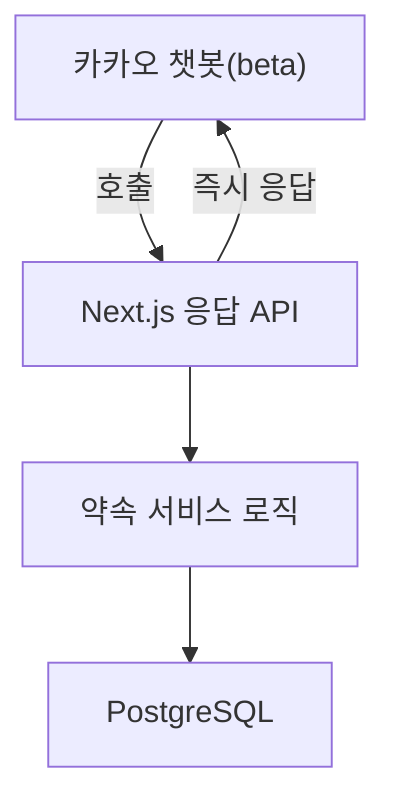

# 기술 스택

> 원본: Notion 「기술 스택」, 「환경 설정」 2절
> 추출일: 2026-10-30

---

## 배포 방식 — Vercel + Neon (확정, R-05)

> 처음에는 문서마다 배포 방식이 달랐습니다(Render·Docker). 지금은 아래가 실제 결정이며, 저장소 문서는 모두 이 기준입니다. 따라 하는 순서는 [`DEPLOY.md`](DEPLOY.md)에 있습니다.

1. **앱은 Vercel, DB는 Neon.**
   - Vercel이 GitHub 저장소를 불러와 `npm run build`(`prisma generate && next build`)로 빌드합니다. Node.js는 `package.json`의 `engines`(24)를 따릅니다.
   - 브랜치·PR마다 **미리보기(Preview) 배포**가 생기고, 미리보기는 Neon 미리보기 브랜치 DB를 씁니다. 운영(Production) DB는 따로 둡니다.
   - 마이그레이션은 빌드에 넣지 않고 사람이 `prisma migrate deploy`로 적용합니다(미리보기: `npm run db:deploy:preview`).
   - Render를 쓰지 않는 이유: 무료 플랜은 15분 유휴 후 잠들고 깨어나는 데 1분이 걸려서 카카오의 **5초 응답 제한을 못 맞춥니다.** 무료 PostgreSQL DB도 **30일 후 만료**됩니다.

2. **Docker는 설치하지 않습니다.**
   DB를 클라우드(Neon)로 쓰기로 해서 필요가 없어졌습니다. 실제 레포에도 `Dockerfile`이 없습니다. 나중에 로컬 Docker DB로 바꾸고 싶으면 `.env` 한 줄만 고치면 되니, 지금 깔 이유가 없습니다.

3. **아래 서술은 구버전입니다. 그대로 따르지 마세요.**
   - 「기술 스택」 토글(오픈빌더 문제 해결 선택지)의 **"Render 절전되지 않는 유료 Web Service 권장"**
   - 노션 PRD 6장의 **"Docker Compose + Render"** (저장소 사본 `docs/product/PRD.md`는 Vercel + Neon으로 고쳤고, 노션 원본은 따로 고칩니다)

---

## 확정 버전

> 아래 버전은 **고정**입니다. 임의로 올리지 마세요. 올릴 일이 생기면 이슈로 올리고 팀원이 같이 결정합니다.

| 항목               | 버전                | 비고                                                                                                                |
| ------------------ | ------------------- | ------------------------------------------------------------------------------------------------------------------- |
| Node.js            | **24.x LTS**        | `.nvmrc`와 `package.json`의 `engines`로 명시                                                                        |
| npm                | Node 24 번들 (11.x) | **12로 올리지 마세요.** lock 파일이 어긋나 팀 설치가 깨질 수 있습니다                                               |
| Next.js            | 16.4.6              | App Router · Turbopack. 웹과 챗봇 API를 한 프로젝트에서. 16.3.5의 보안 취약점(critical) 때문에 마이너 업데이트(030) |
| React              | 19.2.x              | Next가 같이 설치                                                                                                    |
| TypeScript         | 5.x                 | TS 7이 나왔지만 생태계가 아직 5 기준입니다                                                                          |
| prisma (CLI)       | **7.10.0 고정**     | ⚠️ SETUP.md「자주 터지는 오류」의 첫 번째 항목 반드시 읽기                                                          |
| @prisma/client     | **7.10.0 고정**     | CLI와 같은 버전                                                                                                     |
| @prisma/adapter-pg | **7.10.0 고정**     | Prisma 7부터 필수. Prisma 3종은 `package.json`에 `^` 없이 정확한 버전으로 적는다                                    |
| PostgreSQL         | Neon 기본값         | 개발·운영 모두 Neon. 개발은 각자 프로젝트                                                                           |
| Tailwind CSS       | 4.x                 |                                                                                                                     |

---

## 아키텍처

### 💻 Next.js 풀스택

> 빠르게 개발하여 어떤식인지 흐름 확인하기 위해서,
> 이후 기능 추가, 백엔드, 프론트엔드, DB 고도화 작업 예정

### 프로젝트 목표

- MVP 최대한 빨리 구현
- AI가 개발 대부분 담당
- 레포 하나로 관리
- 이후에 기능/보안 강화
- 필요하면 나중에 백엔드 분리

### 사용 도구

- next.js
  - react
  - typescript
- postgreSQL
  - neon
- vercel

### 흐름

카카오 챗봇 → Next.js API → PostgreSQL



Next.js의 예를 들면 `/api/integrations/kakao-beta`에서 요청을 받고, 같은 프로젝트 안의 약속 서비스 함수를 호출한 뒤 응답합니다. 별도의 Python 챗봇 서버를 추가할 필요는 없습니다.

서버가 필요한 이유는 다음 기능들 때문입니다.

- `/약속만들기`: 생성 페이지 링크 발급
- `/약속현황`: PostgreSQL에서 참여·제출 현황 조회
- `/약속결과`: 확정된 시간 조회
- 웹에서 가능 시간 저장
- 마감은 조회 시 계산하고 쓰기 요청 때 상태를 전환, 확정은 방장이 수동으로

---

## 프로젝트 구조

| 경로                       | 역할                                                               |
| -------------------------- | ------------------------------------------------------------------ |
| `app/`                     | 화면과 API. App Router라 폴더 구조가 곧 URL입니다                  |
| `app/api/health/route.ts`  | 연결 확인용 API. DB에 붙는지 볼 때 씁니다                          |
| `lib/prisma.ts`            | **Prisma 싱글턴.** DB를 쓸 때는 항상 여기서 import합니다           |
| `prisma/schema.prisma`     | DB 스키마. ERD 신버전 5개 테이블 (`docs/architecture/DATABASE.md`) |
| `prisma/migrations/`       | 마이그레이션 기록. **Git으로 공유**되고 각자 DB에 적용합니다       |
| `prisma/generated/`        | 자동 생성 코드. Git에 안 올라가고 `prisma generate`로 만듭니다     |
| `prisma.config.ts`         | Prisma CLI 설정. DB 주소를 환경변수에서 읽습니다                   |
| `AGENTS.md` / `CLAUDE.md`  | AI 에이전트용 프로젝트 규칙. `CLAUDE.md`는 `@AGENTS.md` 한 줄      |
| `.github/workflows/ci.yml` | PR마다 타입·린트·빌드를 검사                                       |

> ⚠️ **`new PrismaClient()`를 직접 호출하지 마세요.**
> 개발 중 핫리로드마다 새 연결이 쌓여서 `too many connections`로 죽습니다. 항상 이렇게 가져다 쓰세요.
>
> ```ts
> import { prisma } from "@/lib/prisma";
> ```

<details>
<summary><code>lib/prisma.ts</code> 실제 내용</summary>

```ts
import { PrismaPg } from "@prisma/adapter-pg";
import { PrismaClient } from "@/prisma/generated/client";

const connectionString = process.env.DATABASE_URL;

if (!connectionString) {
  throw new Error("DATABASE_URL이 설정되지 않았습니다. .env 파일을 확인하세요.");
}

const globalForPrisma = globalThis as unknown as {
  prisma: PrismaClient | undefined;
};

export const prisma =
  globalForPrisma.prisma ?? new PrismaClient({ adapter: new PrismaPg({ connectionString }) });

if (process.env.NODE_ENV !== "production") {
  globalForPrisma.prisma = prisma;
}
```

</details>

---

## 외부 API

**MVP 범위에서는 카카오 오픈빌더(카카오 챗봇)만 사용합니다.**

아래 항목은 **MVP 이후** 단계에서 검토합니다. MVP 구현에 포함하지 마세요.

- 네이버 지도 API — MVP 이후
- 카카오 API (로그인, 톡캘린더) — MVP 이후
- ODsay — MVP 이후

---

## 카카오 챗봇

### 관리 콘솔 링크

- [챗봇 관리자센터](https://chatbot.kakao.com/bot/6aad05c087c6230d77fee5b6/setting/chatbot)
- [카카오비즈니스 파트너센터](https://business.kakao.com/space/10696277/channel/_TFlxiX/profile/settings?t_src=business_partnercenter&t_ch=lnb&t_obj=%EC%B1%84%EB%84%90%EC%A0%95%EB%B3%B4_%ED%81%B4%EB%A6%AD)

### 챗봇 beta 제휴 신청서 항목

**서비스 소개**

그룹채팅방에서 친구들과 함께 이용하는 챗봇을 서비스해 보세요. 제안사항을 검토하여 제휴를 통해 챗봇을 선보일 수 있어요!

**제휴제안 등록하기**

- **서비스명 :** 서비스명을 입력해주세요. 예) 카카오톡
- **카테고리 :** 정보 / 교육 / 엔터테인먼트 / 게임 / 예약 / 기타
- **서비스 설명 :** 서비스/개발 중이거나 구성 중인 서비스가 어떤 것인지 입력해 주세요. PlayMCP와 어떤 시너지를 내기를 바라시는지도 알려주세요.

**제휴제안 업체정보**

- **구분 :** 기업 / 개인 / 기타
- **법인명 :** 법인명을 입력해주세요. 예) 카카오
- **제안자명**
- **메일주소 :** 등록하신 제안의 검토 회신과 철회 링크가 포함된 메일이 발송되오니, 수신 가능한 정확한 이메일로 등록 해주시기 바랍니다.
- **홈페이지 주소**

### 5초 응답 제한과 상시 가용성

결론부터 말하면, **서버 프로세스를 반드시 24시간 실행해야 하는 것은 아니지만, 카카오가 호출하는 HTTP 엔드포인트는 언제든 즉시 응답할 수 있어야 합니다.**

카카오 채널 챗봇의 공식 문서는 스킬 서버가 HTTP POST 요청을 받아 JSON으로 응답하는 구조이며, **스킬 서버가 5초 안에 응답해야 하고 타임아웃은 조정할 수 없다**고 안내합니다. 또한 공인 IP 또는 공중망 도메인이 필요합니다. [카카오 비즈니스 스킬 서버 가이드](https://kakaobusiness.gitbook.io/main/tool/chatbot/skill_guide/make_skill)

다만 주의할 점이 있습니다. 우리가 보는 링크는 일반적인 채널 챗봇이 아니라 **그룹채팅방용 '카카오톡 챗봇(beta)' 제휴 페이지**입니다. 공개 페이지에는 제휴 방식만 있고 API 규격이나 5초 제한은 나오지 않습니다. 따라서 5초는 일반 오픈빌더 기준으로는 확인되지만, **그룹채팅용 beta에도 동일하게 적용되는지는 제휴 과정에서 확인해야 합니다.** [카카오톡 챗봇(beta) 제휴 안내](https://with.kakao.com/proposition?page=chatbot&type=service)

#### "항상 켜져 있어야 한다"의 정확한 의미

| 배포 방식                          | 가능 여부        | 주의점                                            |
| ---------------------------------- | ---------------- | ------------------------------------------------- |
| 24시간 실행되는 Next.js 서버       | 가장 안정적      | 호출 즉시 처리 가능                               |
| Vercel·AWS Lambda 등의 서버리스    | 가능             | 콜드 스타트까지 포함해 제한 시간 안에 응답해야 함 |
| 일정 시간 후 잠드는 무료 서버      | 비추천           | 첫 요청 때 서버를 깨우느라 5초를 넘길 수 있음     |
| 개발자 MacBook·로컬 서버           | 운영 불가        | 외부 접근성과 지속성이 보장되지 않음              |
| 오픈빌더에 저장된 고정 응답만 사용 | 별도 서버 불필요 | DB 조회나 약속 현황 같은 동적 기능은 구현 불가    |

즉, 서버리스도 사용 가능하므로 "컴퓨터 한 대가 계속 켜져 있어야 한다"는 뜻은 아닙니다. 하지만 사용자 입장에서는 언제 호출해도 바로 응답해야 하므로 **논리적으로는 상시 가용 상태**여야 합니다.

#### 응답 설계 원칙

- **챗봇 응답 목표:** 5초가 아니라 내부적으로 1\~2초 이내
- **오래 걸리는 작업:** 챗봇 요청 중 실행하지 않고 미리 처리하여 DB에 저장
- **마감 처리:** 조회 시 마감 여부를 계산하고, 쓰기 요청 때 상태를 전환합니다. 확정은 방장이 수동으로 합니다
- 자동 마감 크론(예약 작업)은 MVP 이후 항목입니다

예를 들어 `/약속결과` 호출 시 그 자리에서 모든 참여자의 시간표를 다시 계산하면 위험합니다. 방장이 확정하면 결과가 DB에 저장되므로, 챗봇은 저장된 결과만 읽어 반환하는 방식이 좋습니다.

> ⚠️ 원문에는 이 뒤에 "Render 절전되지 않는 유료 Web Service에 함께 배포" 권장안이 이어지지만, 이는 **구버전**입니다. 이 문서 맨 위의 배포 방식 정리를 따르세요.

#### beta 제휴 시 반드시 확인할 것

1. beta의 실제 응답 제한도 5초인지
2. 지연 응답이나 콜백을 지원하는지
3. 실패 시 카카오가 재시도하는지
4. 요청 인증과 채팅방 식별자를 어떻게 제공하는지
5. 선제적으로 채팅방에 결과를 보낼 수 있는지

---

## 기술 선택 기록

| 선택지                    | 구성                                           | 장점                                                                                                            | 단점                                                                                                               |
| ------------------------- | ---------------------------------------------- | --------------------------------------------------------------------------------------------------------------- | ------------------------------------------------------------------------------------------------------------------ |
| **Next.js 풀스택**        | Next.js + TypeScript + PostgreSQL              | 프론트/백을 한 프로젝트에서 개발, 코드량 적음, AI가 기능 단위로 한 번에 구현하기 좋음, 배포 간단, MVP 매우 빠름 | Next/React/Node/TS를 전부 새로 알아야 함, 프론트/백 경계가 흐려질 수 있음, AI가 만든 구조를 사람이 이해 못 할 위험 |
| **Next.js + FastAPI**     | Next.js + TS / FastAPI + Python / PostgreSQL   | 프론트·백 경계 명확, Python이라 백엔드 이해 쉬움, Spring보다 코드 짧음, AI가 FastAPI를 잘 다룸                  | 프론트와 백 두 앱 관리, API DTO 중복 가능, Next 풀스택보다 구현량 많음                                             |
| **Next.js + Spring Boot** | Next.js + TS / Spring Boot + Java / PostgreSQL | 본인이 백엔드를 이해 가능, 구조 명확, Transaction/권한/복잡한 비즈니스 로직에 강함, 포트폴리오 좋음             | 코드량 많음, Controller/Service/DTO 등 계층이 많음, MVP 속도가 상대적으로 느림                                     |
| **React + FastAPI**       | React + TS / FastAPI + Python                  | 구조 단순, 백엔드 가벼움, SPA 개념이 명확                                                                       | Next.js가 제공하는 라우팅/SSR/서버 기능 등을 따로 처리, 요즘 새 MVP에서 굳이 React만 쓸 이유가 적음                |
| **Python 중심 풀스택**    | Django 또는 Streamlit 등                       | Python 하나 위주로 사용 가능, 본인이 코드 읽기 쉬움                                                             | 일반적인 현대 웹 UI 개발에는 불리함, Streamlit은 제품형 웹서비스 UI에 부적합, AI가 예쁜/복잡한 UX 만들기 어려움    |

**선택 결과: Next.js 풀스택**
