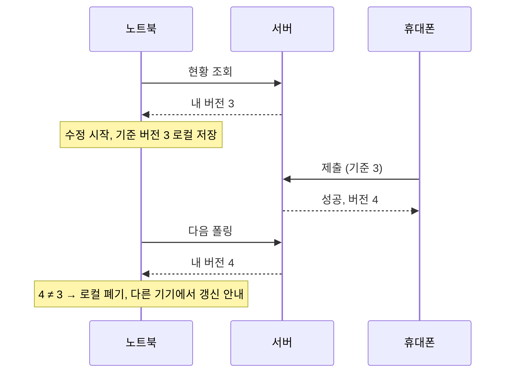

# TIME API 명세

> 원본: Notion 「API」 › 승주 time api › api 명세서 (3)
> 추출일: 2026-10-30
> 공통 규약은 [API_CONVENTIONS.md](../API_CONVENTIONS.md) 참고.
> 동기화 기준은 참여자별 `availability_version` (2026-10-27 확정).

> 💡 TIME-API-01(가능 시간 제출), TIME-API-02(가능 시간 현황 조회)를 이해하기 위한 참고 자료입니다. **(제안)** 표시는 팀 확정 전 내용입니다. 동기화 비교 기준은 참여자별 버전(`availability_version`)을 사용합니다(10/27 확정).

---

## 엔드포인트

### TIME-API-01 — 가능 시간 제출

`PUT /api/v1/promises/{promiseId}/me/availability`

- **도메인:** TIME
- **설명:** 본인의 미래 슬롯을 전체 교체하고 제출 시각·버전을 갱신한다. 기준 버전(baseVersion)이 다르면 거절하고, 범위 밖 슬롯은 빼고 저장하며, 지난 슬롯은 무시하고 기존 기록을 보존한다

#### 0. 규칙 연결

- 도메인: TIME
- 관련 규칙: TIME-02-02(API 시간 형식), TIME-02-03(시간 정밀도), TIME-05-02(자정 넘김), TIME-06-01(슬롯 입력 단위), TIME-07-01(시간 구간 경계), TIME-08-01(과거 슬롯 입력), TIME-10-01~04(저장·제출·반영), TIME-11-01~02(제출 후 수정), TIME-12-01(빈 선택 제출), TIME-15-01~04(마감 판정), STATE-09-04(범위 변경 시 제출 상태), STATE-10-01(취소)
- 권한: 이 약속의 **active 참여자 본인**(방장 포함). 다른 참여자의 입력은 수정할 수 없다.
- 허용 상태: effectiveStatus가 collecting일 때만 허용한다. draft·closed·confirmed·cancelled는 409로 거절하고, 생성 후 10분이 지난 draft는 410 `DRAFT_EXPIRED`(삭제 없음)로 거절한다.
- 상태 전환: DB 상태는 collecting인데 마감 시각이 지났으면, 이 요청이 closed로 전환해 **커밋한 뒤** 409 `VOTING_CLOSED`를 반환한다. 응답은 에러여도 전환은 롤백하지 않는다.
- 동시성: promises 행을 FOR UPDATE로 잠근다. 마감 판정 시각은 잠금을 얻은 뒤의 DB 시각(`clock_timestamp()`)으로 한다.
- 동기화: `participants.availability_version`으로 판단한다. 슬롯이나 제출 상태를 바꾸는 모든 API는 버전을 +1 한다(STATE 범위 변경·재조율 포함). 탈퇴·내보내기는 슬롯·제출 상태를 보존하므로 버전을 올리지 않는다(ERD 6.2).
- 상한: 원본 slots 5,000개 초과 422 `SLOT_LIMIT_EXCEEDED`, 본문 256KB 초과 413 `PAYLOAD_TOO_LARGE` (2026-11-04 확정, DECISION_CONFLICTS R-14)

#### 1. 기본 정보

- **목적:** 내 미래 가능 시간 슬롯 전체를 교체하고(지난 슬롯은 고정) 제출 완료로 기록한다. 처음 제출과 재제출이 같은 API이며 제출 취소 기능은 없다. 빈 배열을 보내면 "가능한 시간 없음"으로 제출된다.
- **HTTP Method:** PUT
- **Endpoint:** `/api/v1/promises/{promiseId}/me/availability`
- **Authentication Required:** 예 (약속별 세션 쿠키)
- **Content Type:** `application/json`

#### 요청

**헤더**

| Name         | Value                                                                          | 필수 |
| ------------ | ------------------------------------------------------------------------------ | ---- |
| Cookie       | `ys_session_{promiseId}=...`                                                   | O    |
| Origin       | 서비스 도메인(`NEXT_PUBLIC_BASE_URL`의 origin, 미리보기는 그 배포 주소 — R-36) | O    |
| Content-Type | `application/json`                                                             | O    |

**Path 파라미터**

| 이름      | 타입          | 설명    | 필수 |
| --------- | ------------- | ------- | ---- |
| promiseId | string (UUID) | 약속 ID | O    |

**Request Body**

| 이름        | 타입          | 설명                                                                                              | 필수 |
| ----------- | ------------- | ------------------------------------------------------------------------------------------------- | ---- |
| baseVersion | integer (≥ 0) | 브라우저가 마지막으로 받은 내 `availability_version`. TIME-API-02의 `me.version` 값               | O    |
| slots       | string[]      | 30분 슬롯 시작 시각 목록. ISO-8601, `+09:00` 필수, 분은 00 또는 30, 초는 0. 0개 이상 5,000개 이하 | O    |

같은 시각이 여러 번 오면 하나로 합치며, 합쳐진 것은 제외 개수에 넣지 않는다. participantId는 받지 않고 대상 참여자는 세션으로만 결정한다.

```json
{
  "baseVersion": 3,
  "slots": ["2026-10-28T14:00:00+09:00", "2026-10-28T14:30:00+09:00", "2026-10-29T10:00:00+09:00"]
}
```

#### 응답

**Status Code: 200 OK**

| 이름             | 타입                            | 설명                                                                                                                              |
| ---------------- | ------------------------------- | --------------------------------------------------------------------------------------------------------------------------------- |
| version          | integer                         | 저장 후 새 버전. 브라우저는 이 값을 다음 baseVersion으로 쓴다                                                                     |
| submitted        | boolean                         | 항상 true                                                                                                                         |
| submittedAt      | string (ISO-8601, 밀리초 3자리) | 제출 시각                                                                                                                         |
| slots            | string[]                        | 저장 후 서버에 있는 내 슬롯 전체(그대로 둔 지난 슬롯 포함). 시각 오름차순. 초 단위 표기(`2026-10-28T14:00:00+09:00`, 밀리초 없음) |
| droppedSlotCount | integer                         | 날짜·하루 시간 범위 밖이라 저장하지 않은 슬롯 수(지난 슬롯은 세지 않음)                                                           |

```json
{
  "version": 4,
  "submitted": true,
  "submittedAt": "2026-10-27T18:35:10.027+09:00",
  "slots": ["2026-10-28T14:00:00+09:00", "2026-10-28T14:30:00+09:00"],
  "droppedSlotCount": 1
}
```

성공하면 브라우저는 로컬 저장값(`{ v: 1, baseVersion, slots }`)을 지운다. droppedSlotCount가 1 이상이면 "범위 밖 시간은 제외하고 저장했어요"를 안내한다. 처리 순서 7번에서 재시도로 판정된 200은 저장을 다시 하지 않으므로 version과 submittedAt이 원래 값 그대로다.

#### 에러

형식: `{ "code", "message", "details"? }` (API_CONVENTIONS 3절). 세션 인증에 성공한 뒤의 모든 응답(에러 포함)은 쿠키를 갱신한다(API_CONVENTIONS 5절).

| HTTP 상태 | code                            | 발생 원인                                                                                                                                                             | message 예시                                              |
| --------- | ------------------------------- | --------------------------------------------------------------------------------------------------------------------------------------------------------------------- | --------------------------------------------------------- |
| 400       | `INVALID_REQUEST`               | promiseId 형식 오류. JSON 파싱 실패, baseVersion(0 이상 정수)·slots(문자열 배열) 누락·타입 오류                                                                       | 요청 형식이 올바르지 않습니다.                            |
| 401       | `UNAUTHENTICATED`               | 세션 쿠키 없음·만료, 탈퇴·내보내진 참여자(잠금 후 재확인 포함, ERD 11절)                                                                                              | 다시 로그인해 주세요.                                     |
| 403       | `INVALID_ORIGIN`                | Origin 헤더 없음·불일치 (A-09)                                                                                                                                        | 허용되지 않은 요청 출처입니다.                            |
| 403       | `FORBIDDEN`                     | 다른 약속의 세션                                                                                                                                                      | 이 작업을 수행할 권한이 없습니다.                         |
| 404       | `PROMISE_NOT_FOUND`             | 없는 약속                                                                                                                                                             | 약속을 찾을 수 없습니다.                                  |
| 409       | `PROMISE_NOT_OPEN`              | draft(방장 설정 중)                                                                                                                                                   | 방장이 약속을 설정 중입니다.                              |
| 409       | `VOTING_CLOSED`                 | 마감·확정됨 (마감 시각에 막 도달한 경우 포함)                                                                                                                         | 응답이 마감되었습니다.                                    |
| 409       | `PROMISE_CANCELLED`             | 취소된 약속                                                                                                                                                           | 취소된 약속입니다.                                        |
| 409       | `AVAILABILITY_VERSION_CONFLICT` | baseVersion ≠ 현재 버전(재시도 아님). details: `{ "currentVersion": 5, "submitted": true, "slots": ["2026-10-28T14:00:00+09:00"] }` (slots는 200과 같은 초 단위 표기) | 다른 기기에서 먼저 저장했어요. 최신 내용을 확인해 주세요. |
| 410       | `DRAFT_EXPIRED`                 | 생성 후 10분이 지난 draft. 링크를 잠그지 않으므로 삭제하지 않는다 (R-12)                                                                                              | 설정 시간이 지나 약속이 만료되었습니다.                   |
| 413       | `PAYLOAD_TOO_LARGE`             | 본문 256KB 초과 (Content-Length와 실제 읽은 크기 모두 확인)                                                                                                           | 요청 본문이 너무 큽니다.                                  |
| 422       | `INVALID_SLOT_FORMAT`           | +09:00 아님, 분이 00·30 아님, 초가 0 아님(밀리초는 .000만 허용), 존재하지 않는 날짜                                                                                   | 시간 형식이 올바르지 않습니다.                            |
| 422       | `SLOT_LIMIT_EXCEEDED`           | 원본 slots 5,000개 초과 (제외·중복 정리 전 개수 기준)                                                                                                                 | 한 번에 저장할 수 있는 시간은 5,000칸까지입니다.          |

409 AVAILABILITY_VERSION_CONFLICT를 받으면 브라우저는 로컬 입력을 폐기하고 "다른 기기에서 먼저 저장했어요"를 안내한 뒤, details의 최신 값(currentVersion·submitted·slots)으로 화면을 다시 그린다. 다시 조회할 필요가 없다(TIME-10-04, ERD 8.2).

#### 처리 순서

1. Origin을 검증한다. 없거나 다르면 403 `INVALID_ORIGIN`. 모든 응답에 `Cache-Control: no-store`.
2. 본문 크기를 확인한다. Content-Length 또는 실제로 읽은 크기가 256KB를 넘으면 413 `PAYLOAD_TOO_LARGE`.
3. 세션 인증 공통 모듈(`lib/member/session-auth.ts`) 순서로 인증한다: promiseId 형식 400 → 약속 없음 404 → cancelled 409 `PROMISE_CANCELLED`(세션 검사보다 먼저) → 세션 없음·만료·cancelled 참여자 401 → 다른 약속 세션 403 `FORBIDDEN`. 이후의 모든 응답은 쿠키를 갱신한다.
4. 트랜잭션 전에 Body 형식을 검사한다. 형식 오류는 400 `INVALID_REQUEST`, 원본 slots가 5,000개를 넘으면 422 `SLOT_LIMIT_EXCEEDED`, 슬롯 문자열 형식 오류는 422 `INVALID_SLOT_FORMAT`. 같은 시각은 하나로 합친다.
5. 트랜잭션을 시작하고 promises 행을 `FOR UPDATE`로 잠근 뒤 DB 현재 시각(`clock_timestamp()`)을 읽어 판정한다. 약속이 사라졌으면 404(쿠키 삭제), cancelled는 409 `PROMISE_CANCELLED`. 이어서 **상태·마감보다 먼저** 세션과 참여자를 다시 확인한다 — 세션 행이 없거나(로그아웃, 쿠키 Max-Age=0) 만료됐거나(탈퇴·내보내기는 세션을 즉시 만료) 참여자가 이 약속의 active 참여자가 아니면 401 `UNAUTHENTICATED`(ERD 11절). 재확인에 실패한 요청은 마감이 지났어도 closed를 저장하지 않는다(STATE-API-09 공통 처리 4, 2026-11-10 R-32에서 순서 변경 — 이전에는 상태·마감 판정 뒤에 재확인). 그다음 draft는 생성 후 10분이 지났으면 410 `DRAFT_EXPIRED`(삭제 없음) 아니면 409 `PROMISE_NOT_OPEN`, closed·confirmed는 409 `VOTING_CLOSED`. collecting인데 현재 시각 ≥ 마감 시각이면 status를 closed로 바꿔 **커밋**한 뒤 409 `VOTING_CLOSED`(에러 응답이어도 전환은 롤백하지 않는다).
6. 저장 가능한 슬롯만 남긴다(DB는 바꾸지 않는다). 한국 날짜가 날짜 범위 안이고, 시작 ≥ 하루 시작 시각이고, 시작 + 30분 ≤ 하루 종료 시각(24:00은 1440분)이어야 한다. (10/27 확정) 지난 슬롯(시작 시각 ≤ 현재)은 거절하지도 저장하지도 않고 무시하며 droppedSlotCount에도 넣지 않는다. 이미 저장된 지난 슬롯은 8번에서 지우지 않고 그대로 둔다(지난 시간은 추가·삭제 불가, TIME-08-01). 재제출 때 화면에 남아 있던 지난 슬롯이 함께 전송돼도 422가 나지 않고, 과거 기록도 보존하기 위해서다.
7. `availability_version`과 baseVersion이 다르면 먼저 재시도인지 확인한다(ERD 8.2). 6번에서 남은 슬롯이 서버에 저장된 내 슬롯(지난 슬롯 제외)과 같고 제출 상태면, 이미 저장된 요청의 재시도로 보고 아무것도 바꾸지 않은 채 200을 반환한다(버전·제출 시각 그대로). 응답이 유실돼 같은 요청을 다시 보낸 경우 충돌로 오인하지 않기 위해서다. 다르면 409 `AVAILABILITY_VERSION_CONFLICT`. 아무것도 저장하지 않고, details에 현재 버전·제출 여부·저장 슬롯을 담아 반환한다(ERD 8.2).
8. 내 기존 슬롯 중 미래 슬롯(시작 시각 > 현재)만 삭제하고 남은 슬롯을 넣는다. 지난 슬롯은 그대로 둔다. 즉 미래 칸은 덮어쓰고 지난 칸은 고정한다. `availability_submitted_at = 현재 시각`, `availability_version + 1`로 갱신한다.
9. 커밋하고 200을 반환한다.

#### 코드 예제

구조를 보여주는 예제이며 모델·헬퍼 이름은 실제 스키마에 맞게 바꾼다. 에러 코드·처리 순서·슬롯 표기는 위 에러 표·처리 순서·응답 표가 기준이다(예제는 정렬 전 코드를 담고 있고, `toKstIso`는 슬롯에도 밀리초를 붙인다). 실제 구현: `app/api/v1/promises/[promiseId]/me/availability/route.ts`, `lib/time/slots.ts`, `lib/time/submit-availability.ts`. 하루 경계는 ERD대로 분 값(`daily_start_minute`·`daily_end_minute`, 24:00=1440)으로 저장돼 있어 숫자 그대로 읽는다. Asia/Seoul은 서머타임이 없어 +9시간 고정 계산이 가능하다.

```ts
// app/api/v1/promises/[promiseId]/me/availability/route.ts
import { z } from "zod";
import { prisma } from "@/lib/prisma";
import { requireSession } from "@/lib/session"; // MEMBER-API-00
import { apiError } from "@/lib/api-error";

const KST = 9 * 60 * 60 * 1000;
const SLOT_RE = /^\d{4}-\d{2}-\d{2}T\d{2}:(00|30):00(\.000)?\+09:00$/;
const Body = z.object({ baseVersion: z.number().int().min(0), slots: z.array(z.string()) });
const toKstIso = (ms: number) => new Date(ms + KST).toISOString().replace("Z", "+09:00");

type PromiseRow = {
  status: string;
  dateStart: string;
  dateEnd: string;
  dailyStart: number;
  dailyEnd: number;
  deadline: Date;
}; // 하루 경계는 분 단위

export async function PUT(req: Request, { params }: { params: Promise<{ promiseId: string }> }) {
  const { promiseId } = await params;
  const session = await requireSession(req, promiseId); // 실패 시 401 응답을 던짐

  const parsed = Body.safeParse(await req.json().catch(() => null));
  if (!parsed.success)
    return apiError(422, "INVALID_REQUEST_BODY", "요청 형식이 올바르지 않습니다.");
  const { baseVersion, slots } = parsed.data;
  if (slots.length > 5000)
    return apiError(422, "SLOT_LIMIT_EXCEEDED", "한 번에 저장할 수 있는 시간은 5,000칸까지입니다.");
  if (!slots.every((s) => SLOT_RE.test(s) && !Number.isNaN(Date.parse(s))))
    return apiError(422, "INVALID_SLOT_FORMAT", "시간 형식이 올바르지 않습니다.");
  const unique = [...new Set(slots.map((s) => Date.parse(s)))];

  const r = await prisma.$transaction(async (tx) => {
    const [p] = await tx.$queryRaw<PromiseRow[]>`
      SELECT status, date_range_start::text AS "dateStart", date_range_end::text AS "dateEnd",
             daily_start_minute AS "dailyStart", daily_end_minute AS "dailyEnd",
             voting_deadline_at AS "deadline"
      FROM promises WHERE id = ${promiseId}::uuid FOR UPDATE`;
    if (!p) return { error: "PROMISE_NOT_FOUND" as const };

    // 잠금을 얻은 "뒤"의 시각 (NOW()는 트랜잭션 시작 시각이라 쓰지 않음)
    const [{ now }] = await tx.$queryRaw<{ now: Date }[]>`SELECT clock_timestamp() AS now`;

    if (p.status === "cancelled") return { error: "PROMISE_CANCELLED" as const };
    if (p.status === "draft") return { error: "PROMISE_NOT_COLLECTING" as const };
    if (p.status !== "collecting") return { error: "VOTING_CLOSED" as const };
    if (now >= p.deadline) {
      await tx.$executeRaw`UPDATE promises SET status = 'closed' WHERE id = ${promiseId}::uuid`;
      return { error: "VOTING_CLOSED" as const }; // 정상 반환 → 전환이 커밋된 뒤 409
    }

    const me = await tx.participant.findUnique({
      where: { id: session.participantId },
      select: {
        promiseId: true,
        status: true,
        availabilityVersion: true,
        availabilitySubmittedAt: true,
      },
    });
    if (!me || me.promiseId !== promiseId || me.status !== "active")
      return { error: "UNAUTHENTICATED" as const }; // 탈퇴·내보내기 포함 (ERD 11절)
    const start = p.dailyStart,
      end = p.dailyEnd; // 분 값 그대로 사용
    const future = unique.filter((ms) => ms > now.getTime()); // 지난 슬롯은 무시 (10/27 확정)
    const kept = future
      .filter((ms) => {
        const k = new Date(ms + KST).toISOString(); // 한국 시각 기준 문자열
        const day = k.slice(0, 10);
        const min = Number(k.slice(11, 13)) * 60 + Number(k.slice(14, 16));
        return day >= p.dateStart && day <= p.dateEnd && min >= start && min + 30 <= end;
      })
      .sort((a, b) => a - b);

    if (me.availabilityVersion !== baseVersion) {
      const cur = await tx.participantAvailableSlot.findMany({
        where: { participantId: session.participantId },
        orderBy: { slotStartAt: "asc" },
        select: { slotStartAt: true },
      });
      const curMs = cur.map((s) => s.slotStartAt.getTime());
      const curFuture = curMs.filter((ms) => ms > now.getTime());
      const sameAsSaved =
        me.availabilitySubmittedAt !== null &&
        curFuture.length === kept.length &&
        curFuture.every((v, i) => v === kept[i]);
      if (sameAsSaved)
        // 이미 저장된 요청의 재시도 → 바꾸지 않고 성공 처리 (ERD 8.2)
        return {
          ok: true as const,
          version: me.availabilityVersion,
          now: me.availabilitySubmittedAt!,
          saved: curMs,
          dropped: future.length - kept.length,
        };
      return {
        error: "AVAILABILITY_VERSION_CONFLICT" as const,
        currentVersion: me.availabilityVersion,
        submitted: me.availabilitySubmittedAt !== null,
        slots: curMs.map((ms) => toKstIso(ms)),
      };
    }

    await tx.participantAvailableSlot.deleteMany({
      where: { participantId: session.participantId, slotStartAt: { gt: now } }, // 지난 슬롯은 보존
    });
    if (kept.length > 0) {
      await tx.participantAvailableSlot.createMany({
        data: kept.map((ms) => ({
          participantId: session.participantId,
          slotStartAt: new Date(ms),
        })),
      });
    }
    const updated = await tx.participant.update({
      where: { id: session.participantId },
      data: { availabilitySubmittedAt: now, availabilityVersion: { increment: 1 } },
      select: { availabilityVersion: true },
    });
    const saved = await tx.participantAvailableSlot.findMany({
      where: { participantId: session.participantId },
      orderBy: { slotStartAt: "asc" },
      select: { slotStartAt: true },
    });
    return {
      ok: true as const,
      version: updated.availabilityVersion,
      now,
      saved: saved.map((s) => s.slotStartAt.getTime()),
      dropped: future.length - kept.length,
    };
  });

  if ("error" in r) {
    const map = {
      PROMISE_NOT_FOUND: [404, "약속을 찾을 수 없습니다."],
      PROMISE_CANCELLED: [409, "취소된 약속입니다."],
      PROMISE_NOT_COLLECTING: [409, "아직 시간을 입력할 수 없습니다."],
      VOTING_CLOSED: [409, "응답이 마감되었습니다."],
      UNAUTHENTICATED: [401, "다시 로그인해 주세요."],
      AVAILABILITY_VERSION_CONFLICT: [
        409,
        "다른 기기에서 먼저 저장했어요. 최신 내용을 확인해 주세요.",
      ],
    } as const;
    const [status, message] = map[r.error];
    const details =
      r.error === "AVAILABILITY_VERSION_CONFLICT"
        ? { currentVersion: r.currentVersion, submitted: r.submitted, slots: r.slots }
        : {};
    return apiError(status, r.error, message, details);
  }

  return Response.json({
    version: r.version,
    submitted: true,
    submittedAt: toKstIso(r.now.getTime()),
    slots: r.saved.map((ms) => toKstIso(ms)),
    droppedSlotCount: r.dropped,
  });
}
```

#### 보안 정보

- 대상 참여자는 세션으로만 정한다. Body·쿼리의 participantId, isHost 값은 받지 않는다.
- 세션이 유효해도 잠금 안에서 active 여부와 약속 소속을 다시 검사한다. 탈퇴한 사람이 쿠키를 들고 있어도 막기 위해서다(ERD 11절).
- 세션 쿠키는 HttpOnly, Secure, SameSite=Lax, Path=`/api/v1/promises/{promiseId}`로 둔다.
- 쓰기 요청이므로 Origin 헤더 검사로 CSRF를 막는다. 실패하면 403 `INVALID_ORIGIN` (필수, 2026-11-04).
- Body 크기 상한은 256KB로 둔다(5,000개 × 약 30바이트에 여유). 초과하면 413 `PAYLOAD_TOO_LARGE` (확정, 2026-11-04).
- 참여자·IP 기준 레이트 리밋을 둔다. **[제안]**
- 로그에 세션 토큰·쿠키 값을 남기지 않는다.

---

### TIME-API-02 — 가능 시간 현황 조회

`GET /api/v1/promises/{promiseId}/availability`

- **도메인:** TIME
- **설명:** 약속 상태(effectiveStatus)와 설정 범위, 제출자의 가능 슬롯, 내 동기화 정보(version·제출 여부·슬롯)를 반환한다. 입력 화면의 5초 폴링 대상이며 다른 참여자의 제출 여부는 표시하지 않는다

#### 0. 규칙 연결

- 도메인: TIME
- 관련 규칙: TIME-02-02(API 시간 형식), TIME-02-03(시간 정밀도), TIME-05-02(자정 넘김), TIME-10-03(미제출 입력 계산), TIME-10-04(제출과 반영), TIME-12-01(빈 선택 제출), TIME-12-02(미제출과 불참 구분), TIME-15-01~04(마감 판정), STATE-09-04(범위 변경 시 제출 상태), STATE-10-01(취소)
- 권한: 이 약속의 **active 참여자**(방장 포함). 비참여자·탈퇴자는 다른 사람의 가능 시간을 볼 수 없다.
- 허용 상태: effectiveStatus가 collecting·closed·confirmed일 때 200. cancelled는 409 `PROMISE_CANCELLED`, draft는 409 `PROMISE_NOT_OPEN`이고 생성 후 10분이 지난 draft는 410 `DRAFT_EXPIRED`(삭제 없음).
- 상태 전환: 없음. DB를 바꾸지 않는다. collecting이면서 마감 시각이 지난 경우 응답의 status만 closed로 계산한다(실제 전환은 쓰기 요청이 한다).
- 동시성: 잠그지 않는다. 약속·참여자·슬롯을 한 시점 기준으로 읽도록 REPEATABLE READ 읽기 트랜잭션 하나에서 조회하고, 판정 시각은 그 트랜잭션 안의 `now()`로 한다(읽기 시점과 일치). (2026-11-05 확정, DECISION_CONFLICTS R-14)
- 폴링: 5초 주기. 마감 후에도 같은 주기로 계속하며, 탭이 숨겨지면 멈추고 돌아오면 즉시 조회한다.
- ETag·304: MVP 미적용. 필요 시 P1에서 검토하며, 응답 형식을 바꾸지 않고 추가할 수 있다.

#### 1. 기본 정보

- **목적:** 입력 화면에 필요한 약속 상태·설정 범위, 참여자별 가능 시간, 내 동기화 정보(version)를 한 번에 제공한다. 입력 화면의 폴링 대상이다.
- **HTTP Method:** GET
- **Endpoint:** `/api/v1/promises/{promiseId}/availability`
- **Authentication Required:** 예 (약속별 세션 쿠키)
- **Content Type:** `application/json`

제출 여부는 본인에게만 알려준다(`me.submitted`). 다른 참여자의 제출 여부·제출 시각은 응답에 넣지 않는다(TIME-12-02).

#### 요청

**헤더**

| Name   | Value                        | 필수 |
| ------ | ---------------------------- | ---- |
| Cookie | `ys_session_{promiseId}=...` | O    |

**Path 파라미터**

| 이름      | 타입          | 설명    | 필수 |
| --------- | ------------- | ------- | ---- |
| promiseId | string (UUID) | 약속 ID | O    |

**Request Body:** 없음

#### 응답

**Status Code: 200 OK**

| 이름                                   | 타입                            | 설명                                                                                                                                                |
| -------------------------------------- | ------------------------------- | --------------------------------------------------------------------------------------------------------------------------------------------------- |
| status                                 | string                          | effectiveStatus. collecting / closed / confirmed. DB가 collecting이어도 현재 시각 ≥ 마감이면 closed                                                 |
| serverTime                             | string (ISO-8601, 밀리초 3자리) | 조회 기준 서버 시각(판정 시각 = 읽기 트랜잭션의 `now()`). 남은 시간 표시와 지난 슬롯 회색 처리에 기기 시계 대신 사용(TIME-15-03). (2026-11-05 확정) |
| settings.dateRangeStart / dateRangeEnd | string (YYYY-MM-DD)             | 선택 가능 날짜 범위(양끝 포함, 한국 날짜)                                                                                                           |
| settings.dailyStartTime / dailyEndTime | string ("HH:mm")                | 하루 선택 가능 시각 경계. 종료는 "24:00" 가능                                                                                                       |
| settings.durationMinutes               | integer                         | 약속 소요 시간(30의 배수)                                                                                                                           |
| settings.votingDeadlineAt              | string (ISO-8601, 초 단위)      | 응답 마감 시각. STATE-API-02 응답과 같은 표기(`2026-10-27T23:00:00+09:00`)                                                                          |
| totalParticipants                      | integer                         | active 참여자 전체 수. 가능 인원 표시의 분모                                                                                                        |
| participants[]                         | array                           | active 참여자 목록. 등록순(`created_at`, 같으면 `id`)                                                                                               |
| participants[].participantId           | string (UUID)                   | 참여자 ID                                                                                                                                           |
| participants[].nickname                | string                          | 표시 이름                                                                                                                                           |
| participants[].isHost                  | boolean                         | 방장 여부(표시용)                                                                                                                                   |
| participants[].availableSlots          | string[]                        | 제출 완료자만 저장된 슬롯을 담는다. 미제출·제출 해제·빈 선택 제출은 모두 []. 시각 오름차순. TIME-API-01과 같은 초 단위 표기(밀리초 없음)            |
| me.participantId                       | string (UUID)                   | 내 참여자 ID                                                                                                                                        |
| me.version                             | integer                         | 내 availability_version. TIME-API-01의 baseVersion으로 쓴다                                                                                         |
| me.submitted                           | boolean                         | 내 제출 여부. 제출 해제 상태면 false                                                                                                                |
| me.slots                               | string[]                        | 서버에 저장된 내 슬롯(초 단위 표기, 밀리초 없음). 제출 해제 상태에서도 그대로 보여줘 확인 후 다시 제출할 수 있게 한다                               |

participants[] 안의 내 항목은 다른 사람과 같은 규칙을 따른다. 그래서 제출 해제 상태면 내 항목의 availableSlots는 []이고, me.slots에는 저장된 슬롯이 남아 있다. 지난 시각 슬롯도 저장된 그대로 내려주며, 화면에서 serverTime 기준으로 지난 칸을 구분한다.

```json
{
  "status": "collecting",
  "serverTime": "2026-10-27T18:40:02.311+09:00",
  "settings": {
    "dateRangeStart": "2026-10-28",
    "dateRangeEnd": "2026-11-03",
    "dailyStartTime": "09:00",
    "dailyEndTime": "24:00",
    "durationMinutes": 120,
    "votingDeadlineAt": "2026-10-27T23:00:00+09:00"
  },
  "totalParticipants": 3,
  "participants": [
    {
      "participantId": "a1f0c2d4-1b2c-4d3e-8f90-1234567890ab",
      "nickname": "승주",
      "isHost": true,
      "availableSlots": ["2026-10-28T14:00:00+09:00", "2026-10-28T14:30:00+09:00"]
    },
    {
      "participantId": "b2e1d3c5-2c3d-4e5f-9a01-234567890abc",
      "nickname": "연성",
      "isHost": false,
      "availableSlots": []
    },
    {
      "participantId": "c3f2e4d6-3d4e-4f60-ab12-34567890abcd",
      "nickname": "혜승",
      "isHost": false,
      "availableSlots": ["2026-10-28T14:00:00+09:00"]
    }
  ],
  "me": {
    "participantId": "a1f0c2d4-1b2c-4d3e-8f90-1234567890ab",
    "version": 4,
    "submitted": true,
    "slots": ["2026-10-28T14:00:00+09:00", "2026-10-28T14:30:00+09:00"]
  }
}
```

#### 에러

형식: `{ "code", "message", "details"? }` (API_CONVENTIONS 3절). 세션 인증에 성공한 뒤의 모든 응답(에러 포함)은 쿠키를 갱신한다(API_CONVENTIONS 5절). 모든 응답에 `Cache-Control: no-store`.

| HTTP 상태 | code                | 발생 원인                                                                     | message 예시                            |
| --------- | ------------------- | ----------------------------------------------------------------------------- | --------------------------------------- |
| 400       | `INVALID_REQUEST`   | promiseId 형식 오류                                                           | 요청 형식이 올바르지 않습니다.          |
| 401       | `UNAUTHENTICATED`   | 세션 쿠키 없음·만료, 탈퇴·내보내진 참여자(트랜잭션 안 재확인 포함, ERD 11절)  | 다시 로그인해 주세요.                   |
| 403       | `FORBIDDEN`         | 다른 약속의 세션                                                              | 이 작업을 수행할 권한이 없습니다.       |
| 404       | `PROMISE_NOT_FOUND` | 없는 약속                                                                     | 약속을 찾을 수 없습니다.                |
| 409       | `PROMISE_NOT_OPEN`  | draft(방장 설정 중)                                                           | 방장이 약속을 설정 중입니다.            |
| 409       | `PROMISE_CANCELLED` | 취소된 약속. 데이터는 보관하지만 내용은 보여주지 않는다                       | 취소된 약속입니다.                      |
| 410       | `DRAFT_EXPIRED`     | 생성 후 10분이 지난 draft. 조회는 DB를 바꾸지 않으므로 삭제하지 않는다 (R-12) | 설정 시간이 지나 약속이 만료되었습니다. |

#### 처리 순서

1. 읽기 요청이므로 Origin은 검사하지 않는다. 모든 응답에 `Cache-Control: no-store`.
2. 세션 인증 공통 모듈(`lib/member/session-auth.ts`) 순서로 인증한다: promiseId 형식 400 → 약속 없음 404 → cancelled 409 `PROMISE_CANCELLED`(세션 검사보다 먼저) → 세션 없음·만료·cancelled 참여자 401 → 다른 약속 세션 403 `FORBIDDEN`. 이후의 모든 응답은 쿠키를 갱신한다.
3. REPEATABLE READ 읽기 트랜잭션을 시작한다. 잠금은 걸지 않는다. 판정 시각은 트랜잭션 안의 `now()`다.
4. promises 행을 읽는다. 인증 뒤 사라졌으면(만료 draft 정리) 404이고 쿠키를 지운다. 하루 경계는 분 값(`daily_start_minute`·`daily_end_minute`)으로 읽어 응답에서 "HH:mm"으로 바꾼다(1440 → "24:00").
5. 상태를 판정한다. cancelled는 409 `PROMISE_CANCELLED`, draft는 `created_at + 10분 ≤ 판정 시각`이면 410 `DRAFT_EXPIRED`(삭제 없음) 아니면 409 `PROMISE_NOT_OPEN`.
6. 세션과 참여자를 다시 확인한다. 세션이 없거나 만료됐거나(탈퇴·내보내기는 세션을 즉시 만료) 참여자가 이 약속의 active 참여자가 아니면 401 `UNAUTHENTICATED`(ERD 11절).
7. effectiveStatus를 계산한다. collecting이면서 판정 시각 ≥ 마감이면 closed로 계산만 하고 DB는 바꾸지 않는다. closed·confirmed는 그대로.
8. active 참여자와 그 슬롯을 등록순으로 읽는다. 제출 시각이 있는 참여자만 availableSlots에 슬롯을 담고, 나머지는 []로 둔다.
9. 내 version·제출 여부·저장 슬롯으로 me를 만들고 200을 반환한다.

브라우저 동기화 규칙: 폴링 응답의 me.version이 로컬 저장값의 baseVersion과 다르면 다른 기기 제출이나 범위 변경으로 내 데이터가 바뀐 것이다. 로컬 입력을 폐기하고 "다른 곳에서 내용이 바뀌었어요"를 안내한 뒤 me.slots로 화면을 다시 그린다(TIME-10-04).

#### 코드 예제

구조를 보여주는 예제이며 모델·헬퍼 이름은 실제 스키마에 맞게 바꾼다. 에러 코드·처리 순서·시각 표기는 위 에러 표·처리 순서·응답 표가 기준이다(예제는 정렬 전 코드를 담고 있다 — 세션 재확인·draft 410·`toKstIso`가 슬롯·마감에도 밀리초를 붙이는 점이 다르다). 실제 구현: `app/api/v1/promises/[promiseId]/availability/route.ts`, `lib/time/availability-status.ts`. 읽기 트랜잭션 안의 `now()`는 스냅샷 시점과 같아 조회 데이터와 판정 시각이 일치한다.

```ts
// app/api/v1/promises/[promiseId]/availability/route.ts
import { Prisma } from "@prisma/client";
import { prisma } from "@/lib/prisma";
import { requireSession } from "@/lib/session"; // MEMBER-API-00
import { apiError } from "@/lib/api-error";

const KST = 9 * 60 * 60 * 1000;
const toKstIso = (d: Date) => new Date(d.getTime() + KST).toISOString().replace("Z", "+09:00");
const toHHmm = (m: number) =>
  // 540 → "09:00", 1440 → "24:00"
  `${String(Math.floor(m / 60)).padStart(2, "0")}:${String(m % 60).padStart(2, "0")}`;

type PromiseRow = {
  status: string;
  dateStart: string;
  dateEnd: string;
  dailyStart: number;
  dailyEnd: number;
  durationMinutes: number;
  deadline: Date;
  now: Date;
}; // 하루 경계는 분 단위

export async function GET(req: Request, { params }: { params: Promise<{ promiseId: string }> }) {
  const { promiseId } = await params;
  const session = await requireSession(req, promiseId); // 실패 시 401 응답을 던짐

  const r = await prisma.$transaction(
    async (tx) => {
      const [p] = await tx.$queryRaw<PromiseRow[]>`
      SELECT status, date_range_start::text AS "dateStart", date_range_end::text AS "dateEnd",
             daily_start_minute AS "dailyStart", daily_end_minute AS "dailyEnd",
             duration_minutes AS "durationMinutes", voting_deadline_at AS "deadline", now() AS "now"
      FROM promises WHERE id = ${promiseId}::uuid`;
      if (!p) return { error: "PROMISE_NOT_FOUND" as const };
      if (p.status === "cancelled") return { error: "PROMISE_CANCELLED" as const };
      if (p.status === "draft") return { error: "PROMISE_NOT_COLLECTING" as const };
      const status = p.status === "collecting" && p.now >= p.deadline ? "closed" : p.status;

      const people = await tx.participant.findMany({
        where: { promiseId, status: "active" },
        orderBy: { createdAt: "asc" },
        select: {
          id: true,
          nickname: true,
          role: true,
          availabilitySubmittedAt: true,
          availabilityVersion: true,
          availableSlots: { select: { slotStartAt: true }, orderBy: { slotStartAt: "asc" } },
        },
      });
      const me = people.find((x) => x.id === session.participantId);
      if (!me) return { error: "UNAUTHENTICATED" as const }; // 탈퇴·내보내기 포함 (ERD 11절)

      return { ok: true as const, p, status, people, me };
    },
    { isolationLevel: Prisma.TransactionIsolationLevel.RepeatableRead },
  );

  if ("error" in r) {
    const map = {
      PROMISE_NOT_FOUND: [404, "약속을 찾을 수 없습니다."],
      PROMISE_CANCELLED: [409, "취소된 약속입니다."],
      PROMISE_NOT_COLLECTING: [409, "방장이 약속을 설정 중입니다."],
      UNAUTHENTICATED: [401, "다시 로그인해 주세요."],
    } as const;
    const [status, message] = map[r.error];
    return apiError(status, r.error, message);
  }

  const { p, status, people, me } = r;
  const slotsOf = (x: (typeof people)[number]) =>
    x.availableSlots.map((s) => toKstIso(s.slotStartAt));

  return Response.json(
    {
      status,
      serverTime: toKstIso(p.now),
      settings: {
        dateRangeStart: p.dateStart,
        dateRangeEnd: p.dateEnd,
        dailyStartTime: toHHmm(p.dailyStart),
        dailyEndTime: toHHmm(p.dailyEnd),
        durationMinutes: p.durationMinutes,
        votingDeadlineAt: toKstIso(p.deadline),
      },
      totalParticipants: people.length,
      participants: people.map((x) => ({
        participantId: x.id,
        nickname: x.nickname,
        isHost: x.role === "host",
        availableSlots: x.availabilitySubmittedAt ? slotsOf(x) : [], // 제출 여부 자체는 노출하지 않음
      })),
      me: {
        participantId: me.id,
        version: me.availabilityVersion,
        submitted: me.availabilitySubmittedAt !== null,
        slots: slotsOf(me),
      },
    },
    { headers: { "Cache-Control": "no-store" } },
  );
}
```

#### 보안 정보

- 다른 참여자의 제출 여부·제출 시각·version은 응답에 넣지 않는다. 미제출과 빈 선택 제출이 응답에서 구분되지 않아야 한다(TIME-12-02).
- 세션이 유효해도 매 요청 active 여부와 약속 소속을 다시 검사한다. 탈퇴한 사람의 쿠키로는 조회할 수 없다.
- 취소된 약속은 데이터를 보관하더라도 이 API로 내용을 내려주지 않는다(STATE-10-01).
- 개인별 응답이 담기므로 `Cache-Control: no-store`로 중간 캐시 저장을 막는다.
- 폴링 대상이므로 세션 기준 레이트 리밋을 둔다. 5초 주기 기준 탭당 분당 약 12회이므로 여유를 둔 한도로 정한다. **[제안]**

---

## 제출·동기화 흐름

### 기본 흐름

1. 승주가 화요일 14:00~16:00을 드래그하면 브라우저 localStorage에만 저장된다(키: 약속ID+참여자ID). 다른 사람 화면에는 아직 "불가능"으로 보인다.
2. 제출하면 TIME-API-01이 호출되고, 서버가 승주의 기존 슬롯 전체를 교체한 뒤 버전을 +1 하고 제출 시각을 기록한다.
3. 성공하면 로컬 입력을 삭제하고 본인 화면을 즉시 갱신한다.
4. 다른 참여자는 다음 폴링(최대 5초 후)에 TIME-API-02로 변경을 확인한다.

### 두 기기 충돌



노트북이 폴링 전에 제출하더라도 서버가 "기준 3 ≠ 현재 4"로 409 `AVAILABILITY_VERSION_CONFLICT`를 반환하므로, 휴대폰의 제출이 덮어써지지 않는다.

### 제출 해제 (범위 확대)

1. 승주가 수정 중이다(기준 버전 3).
2. 방장이 종료일을 늘리면 STATE-09-04에 따라 승주의 제출이 해제되고, STATE 범위 변경 API가 버전을 4로 올린다.
3. 다음 폴링에서 "기준 3 ≠ 현재 4"이므로 로컬을 폐기하고, 서버에 남은 슬롯(`me.slots`)을 보여준 뒤 새 범위를 확인해 다시 제출하도록 안내한다.

### 왜 제출 시각이 아니라 버전인가

1. 제출 시각으로 비교하면 null(미제출)이 여러 번 반복될 수 있다.
2. 예: 미제출 상태에서 노트북 입력 시작(기준 null) → 휴대폰에서 제출(10:05) → 범위 확대로 제출 해제(null) → 노트북 복귀.
3. 이때 "null = null"로 판단해, 휴대폰에서 제출한 내용이 노트북의 옛날 입력으로 조용히 덮어써진다.
4. 버전은 올라가기만 하고 같은 값이 다시 나오지 않으므로 이 문제가 생기지 않는다(0 → 1 → 2, 2 ≠ 0).

### 범위 축소

1. 승주의 로컬 입력에 토·일 슬롯이 있다.
2. 방장이 종료일을 금요일로 줄인다. 제출 상태는 유지된다. 서버에 저장된 승주의 슬롯 중 범위 밖이 있었다면 STATE 범위 변경 API가 삭제하고 버전을 +1 하므로, 다음 폴링에서 갱신 안내가 뜬다. 서버 슬롯이 그대로면 버전도 그대로이고 로컬 입력도 남는다.
3. 승주가 제출하면 서버는 토·일을 빼고 저장하고 droppedSlotCount: 2를 응답한다.
4. 화면은 "변경된 범위 밖의 시간은 제외하고 저장했어요"를 안내한다.

---

## 상태별 허용 표

| 상태       | 제출 (TIME-API-01)                                   | 현황 조회 (TIME-API-02)                              | 비고                                       |
| ---------- | ---------------------------------------------------- | ---------------------------------------------------- | ------------------------------------------ |
| draft      | 409 PROMISE_NOT_OPEN (10분 지나면 410 DRAFT_EXPIRED) | 409 PROMISE_NOT_OPEN (10분 지나면 410 DRAFT_EXPIRED) | 방장 설정 중. 두 API 모두 삭제 없음 (R-14) |
| collecting | 가능                                                 | 가능 (5초 폴링)                                      | 마감 시각이 지났으면 closed로 처리         |
| closed     | 409 VOTING_CLOSED                                    | 가능 (본인 입력 확인, STATE-06-02)                   | 5초 폴링 유지 (확정·재조율 반영)           |
| confirmed  | 409 VOTING_CLOSED                                    | 가능                                                 | 입력 잠금 (STATE-08-01)                    |
| cancelled  | 409 PROMISE_CANCELLED                                | 409 PROMISE_CANCELLED                                | 데이터는 보관, 조회·수정 불가 (10/13 결정) |

마감 판정: 조회 API는 DB를 바꾸지 않고 `effectiveStatus`로 계산해 응답한다. 실제 closed 전환은 쓰기 요청이 처리한다. 모든 API가 이 함수로 상태를 판단한다(MEMBER-API-00 추가 요청).

---

## 시간 표기 규약

| 구분                                                 | 형식                                  | 예시                                           | 근거                                                                                                                                                             |
| ---------------------------------------------------- | ------------------------------------- | ---------------------------------------------- | ---------------------------------------------------------------------------------------------------------------------------------------------------------------- |
| 실제 시점 (슬롯·마감·확정)                           | ISO-8601, +09:00 포함, 초 단위        | `2026-10-20T14:00:00+09:00`                    | TIME-01-01, 02-01                                                                                                                                                |
| 슬롯 응답 (TIME-API-01 200·409 details, TIME-API-02) | 초 단위, 밀리초 없음                  | `2026-10-28T14:00:00+09:00`                    | 30분 경계라 밀리초가 의미 없음. 같은 시각이 문자열로 같아야 화면 비교가 맞는다 (R-14)                                                                            |
| 제출 시각·서버 시각                                  | ISO-8601, 밀리초 3자리                | `2026-10-12T14:35:10.027+09:00`                | 제출 시각(submittedAt)은 제출 여부 판단용(비교에는 사용 안 함), 서버 시각(TIME-API-02 serverTime)은 기기 시계 대신 쓰는 기준 시각. 밀리초 3자리는 이 둘에만 쓴다 |
| 버전                                                 | 정수, 참여자별, 0부터 시작            | `4`                                            | TIME-10-04 (10/27 확정)                                                                                                                                          |
| 로컬 저장 형식                                       | v(저장 형식 버전), baseVersion, slots | `{ "v": 1, "baseVersion": 3, "slots": [...] }` | 저장 형식 변경 대비                                                                                                                                              |
| 날짜 범위                                            | YYYY-MM-DD (한국 날짜)                | `2026-10-20`                                   | TIME-02-01                                                                                                                                                       |
| 하루 시각                                            | "HH:mm" 문자열, 24:00 허용            | `"09:00"`, `"24:00"`                           | TIME-05-02                                                                                                                                                       |
| DB 타입                                              | 실제 시점은 Timestamptz(3)            | `@db.Timestamptz(3)`                           | TIME-02-03                                                                                                                                                       |
| 마감 판정                                            | 서버 시각, 현재 ≥ 마감 시각이면 마감  | 14:00:00.000 제출은 거절                       | STATE-05-01                                                                                                                                                      |

- 슬롯 범위 검사: 한국 날짜가 날짜 범위 안이고, 시작 ≥ 하루 시작 시각, 시작 + 30분 ≤ 하루 종료 시각(24:00은 1440분으로 계산). 지난 슬롯(시작 ≤ 현재)은 무시하고, 이미 저장된 지난 슬롯은 보존한다 (제안).
- 24:00 주의: Prisma가 time 값을 JS Date로 바꾸면 다음 날 00:00으로 넘어가므로, API에서는 문자열로 주고받는다.

---

## 도메인 경계

| 하는 일                                                          | 담당   | TIME과의 관계                      |
| ---------------------------------------------------------------- | ------ | ---------------------------------- |
| 가능 시간 제출, 현황 조회                                        | TIME   | 직접 처리                          |
| 로컬 저장, 날짜 선택 토글, 폴링 주기                             | 프론트 | API 없음                           |
| 범위·소요 시간 설정, 범위 밖 슬롯 삭제, 제출 해제(둘 다 버전 +1) | STATE  | 결과(바뀐 범위·버전)만 읽음        |
| 조기 마감, 재조율, 취소                                          | STATE  | 상태만 확인                        |
| 후보 계산, 확정                                                  | RESULT | 제출값을 제공                      |
| 인증, 탈퇴, 명단                                                 | MEMBER | 공통 세션 규약(MEMBER-API-00) 사용 |

---

## 용어

- **미제출**: 한 번도 제출하지 않았거나 제출이 해제된 상태. 제출 시각이 비어 있다. 화면에는 모든 시간 "불가능"(TIME-12-02).
- **빈 선택 제출**: 슬롯 0개로 제출한 것. 모든 시간 불가능이며 제출 시각은 있다(TIME-12-01).
- **재제출**: 제출 후 수정해서 다시 제출하는 것. 재제출 전까지 기존 제출값이 유지된다(TIME-11-02).
- **제출 해제**: 범위가 늘어나 서버가 제출 시각을 비우고 버전을 +1 하는 것(STATE-09-04). 다시 제출하기 전까지 미제출로 본다(TIME-10-03). DB의 슬롯은 남아 있지만 다른 참여자에게는 보이지 않는다.
- **기준 버전**: 로컬 수정을 시작한 시점의 서버 버전. 서버 값과 다르면 로컬을 폐기하고 제출을 거절한다(TIME-10-04).
- **재설정**: collecting 중 설정 변경. 상태는 그대로다(STATE-01-02).
- **재조율**: closed·confirmed를 collecting으로 되돌리는 것(STATE-01-02).
- **제출 취소**: 기능 없음. 빈 선택으로 재제출하면 같은 결과다.
- **취소된 약속**: 상태만 cancelled로 바꾸고 데이터는 모두 보관한다. 화면과 API에서는 "취소된 약속입니다"만 보여준다(10/13 결정). 탈퇴·내보내기도 데이터를 보존하며, 해당 참여자만 status=cancelled로 집계에서 제외한다(10/27 결정).

---

## 결정·미결 목록

### 결정 완료 (10/13)

- [x] 범위 밖 슬롯은 거절하지 않고 빼고 저장, droppedSlotCount 반환
- [x] 마감 경계: 현재 ≥ 마감 시각이면 마감
- [x] 조회 API는 마감이 지난 collecting을 DB 변경 없이 closed로 계산
- [x] 슬롯 최대 5,000개
- [x] 마감 후에도 5초 간격으로 폴링을 계속한다. 탭이 숨겨지면 중지하고, 돌아오면 즉시 조회한다.
- [x] 취소된 약속의 데이터는 삭제하지 않고 모두 보관
- [x] TIME-10-04: "새로우면" → "다르면"
- [x] TIME-10-03: "범위 변경으로 제출이 해제된 참여자는 다시 제출하기 전까지 미제출로 본다" 추가
- [x] TIME-10-02 예시: "미응답으로 표시" → "불가능으로 표시"
- [x] TIME-11-01: "재조율은 후속 범위다" 삭제
- [x] STATE-06-02: "제출 취소" 삭제

### 결정 완료 (10/27)

- [x] 동기화 기준은 참여자별 버전(availability_version)으로 확정
- [x] 슬롯이나 제출 상태를 바꾸는 모든 쓰기는 버전 +1 (TIME 제출, STATE 범위 확대·축소·재조율). ERD 3.3 규칙과 동일
- [x] 탈퇴·내보내기 시 입력·제출 기록을 삭제하지 않고 보존한다. 슬롯·제출 상태가 바뀌지 않으므로 버전도 올리지 않는다(ERD 6.2)
- [x] TIME-API-01·02 최종본 작성

### 후속 반영 필요

- [ ] BR TIME-10-04·02-03 문구를 버전 기준으로 수정
- [ ] STATE 범위 변경 API에 버전 +1 반영 (혜승님)
- [ ] MEMBER 탈퇴·내보내기 API: 데이터 보존, status=cancelled, 세션 즉시 만료 (ERD 6.2, 연성님)
- [ ] ERD 5.2절 첫 문장을 지난 슬롯 처리 결정에 맞게 수정 (ERD 담당)
- [ ] BR TIME-08-01 추가 결정에 지난 슬롯 처리 방식 추가

### 제안 (팀 확인 필요)

- [x] 지난 슬롯은 거절하지 않고 무시, 이미 저장된 지난 슬롯은 보존(미래 칸만 덮어쓰기) (TIME-API-01 처리 순서 6·8)
- [x] 재시도 처리 (2026-11-04 확정): 버전이 달라도 서버 저장 슬롯이 요청과 같고 제출 상태면 409 대신 200 (TIME-API-01 처리 순서 7). 응답 유실 후 같은 요청을 다시 보낸 경우 대비
- [x] 슬롯 5,000개 초과 시 422 SLOT_LIMIT_EXCEEDED (2026-11-04 확정)
- [x] TIME-API-02의 serverTime 필드, REPEATABLE READ 조회 (2026-11-05 확정, DECISION_CONFLICTS R-14)
- [x] 상태 관련 에러 코드를 MEMBER-API-00에서 통일 — TIME-API-01은 2026-11-04, TIME-API-02는 2026-11-05 정렬(DECISION_CONFLICTS R-14). VOTING_CLOSED는 유지. (참여 등록의 PROMISE_NOT_OPEN·DEADLINE_PASSED와 TIME의 PROMISE_NOT_COLLECTING·VOTING_CLOSED, 탈퇴자 세션의 401과 403)

### 미결 (다음 회의)

- [x] TIME-API-02에 ETag(304) 적용 여부
- [ ] MEMBER-API-00에 effectiveStatus 공통 규칙 추가 (연성님 담당)
- [ ] STATE-10-01: "삭제한다" → "보관하되 조회·수정할 수 없다" 문구 수정 (혜승님 담당)
